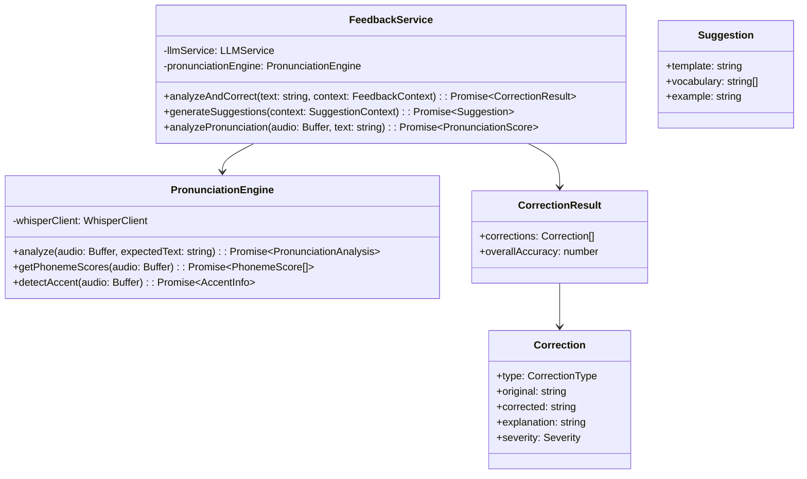

# 5.6. Feedback Module

## 概要

| 項目         | 内容                             |
| ------------ | -------------------------------- |
| モジュール名 | FeedbackModule                   |
| 責務         | 訂正生成、提案生成、発音分析     |
| 依存         | ConversationModule, CommonModule |
| 関連 UC      | UC-004, UC-006, UC-030           |

---

## クラス図



---

## analyzeAndCorrect() 詳細

**処理フロー:**

1. **文法分析**: LLM で文法エラーを検出
2. **語彙分析**: 不適切な単語使用を検出
3. **自然さ分析**: より自然な表現を提案
4. **深刻度判定**: 各エラーの重要度を判定

**訂正タイプ:**

| タイプ        | 説明           | 例                                |
| ------------- | -------------- | --------------------------------- |
| grammar       | 文法エラー     | "I want go" → "I want to go"      |
| vocabulary    | 語彙の選択ミス | "take a photo" → "take a picture" |
| pronunciation | 発音・抑揚     | 音声分析結果から                  |
| naturalness   | より自然な表現 | "I'm happy" → "That's great!"     |

**深刻度:**

| 深刻度 | 表示タイミング | 説明                   |
| ------ | -------------- | ---------------------- |
| high   | 即時表示       | 意味が通じないエラー   |
| medium | 会話後サマリー | 文法的に不正だが通じる |
| low    | 詳細分析のみ   | スタイルの問題         |

---

## generateSuggestions() 詳細

**目的:** 次の発話のヒントを提供

**生成ロジック:**

1. 会話コンテキストから次の発話パターンを予測
2. ユーザーレベルに適した語彙を選択
3. テンプレート形式で穴埋め式に提示

**出力例:**

```typescript
{
  template: "I usually [___] because [___].",
  vocabulary: ["work from home", "go to the gym", "read books"],
  example: "I usually work from home because it's more flexible."
}
```

---

## analyzePronunciation() 詳細

**目的:** 発音の詳細分析（Premium 機能）

**分析項目:**

| 項目       | スコア範囲 | 説明         |
| ---------- | ---------- | ------------ |
| accuracy   | 0-100      | 発音の正確さ |
| fluency    | 0-100      | 流暢さ       |
| intonation | 0-100      | 抑揚の自然さ |
| stress     | 0-100      | 強勢の正確さ |

**出力:**

```typescript
interface PronunciationScore {
  overall: number; // 総合スコア
  accuracy: number;
  fluency: number;
  intonation: number;
  stress: number;
  phonemes: PhonemeScore[]; // 音素ごとのスコア
  suggestions: string[]; // 改善提案
}
```

---

← [Conversation Module](./conversation-module.md) | _次: [Learning Module](./learning-module.md)_
