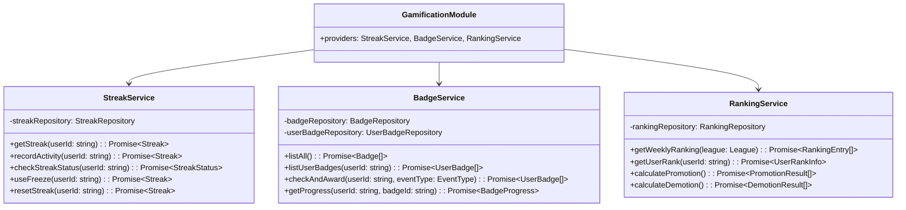

# 5.8. Gamification Module

## 概要

| 項目         | 内容                                       |
| ------------ | ------------------------------------------ |
| モジュール名 | GamificationModule                         |
| 責務         | ストリーク、XP、バッジ、レベル、ランキング |
| 依存         | UserModule, LearningModule, CommonModule   |
| 関連 UC      | UC-018, UC-019, UC-020, UC-028             |

---

## クラス図



---

## StreakService 詳細

### recordActivity()

**目的:** 学習活動を記録し、ストリーク更新

**処理フロー:**

1. 今日の活動が初回か確認
2. 初回の場合:
   - last_activity_date を今日に更新
   - 昨日も活動していた場合: current_streak +1
   - 昨日活動なし + フリーズあり: フリーズ使用、streak 維持
   - 昨日活動なし + フリーズなし: streak リセット
3. longest_streak を更新（必要に応じて）
4. ストリーク達成バッジをチェック

**Pseudocode:**

```typescript
async function recordActivity(userId: string): Promise<Streak> {
  const streak = await getStreak(userId);
  const today = getToday();
  const yesterday = getYesterday();

  // 今日既に記録済み
  if (isSameDay(streak.lastActivityDate, today)) {
    return streak;
  }

  // 昨日活動していた → ストリーク継続
  if (isSameDay(streak.lastActivityDate, yesterday)) {
    streak.currentStreak += 1;
  }
  // 昨日活動なし
  else if (streak.lastActivityDate < yesterday) {
    if (streak.freezeRemaining > 0) {
      streak.freezeRemaining -= 1;
      // ストリーク維持
    } else {
      streak.currentStreak = 1; // リセット
    }
  }

  streak.lastActivityDate = today;
  streak.longestStreak = Math.max(streak.longestStreak, streak.currentStreak);

  await save(streak);

  // バッジチェック
  await badgeService.checkAndAward(userId, "STREAK_" + streak.currentStreak);

  return streak;
}
```

---

## BadgeService 詳細

### バッジ定義

| カテゴリ   | バッジ ID          | 条件                    | XP ボーナス |
| ---------- | ------------------ | ----------------------- | ----------- |
| ストリーク | STREAK_7           | 7 日連続学習            | 100         |
| ストリーク | STREAK_30          | 30 日連続学習           | 500         |
| ストリーク | STREAK_100         | 100 日連続学習          | 2000        |
| レベル     | LEVEL_5            | レベル 5 達成           | 200         |
| レベル     | LEVEL_10           | レベル 10 達成          | 1000        |
| 会話       | CONV_FIRST         | 初回会話完了            | 50          |
| 会話       | CONV_100           | 会話 100 回達成         | 500         |
| 発音       | PRON_PERFECT       | 発音スコア 100 点       | 100         |
| 語彙       | VOCAB_100          | 語彙 100 個登録         | 300         |
| チャレンジ | CHALLENGE_STREAK_7 | チャレンジ 7 日連続完了 | 150         |

### checkAndAward()

**処理フロー:**

1. イベントタイプに関連するバッジ条件を取得
2. 各バッジについて達成条件をチェック
3. 未獲得かつ条件達成の場合:
   - UserBadge レコード作成
   - 通知送信
   - XP ボーナス付与

---

## RankingService 詳細

### リーグシステム

| リーグ   | 必要レベル | 昇格条件 | 降格条件  |
| -------- | ---------- | -------- | --------- |
| Bronze   | 1          | Top 10   | -         |
| Silver   | 2          | Top 10   | Bottom 10 |
| Gold     | 3          | Top 10   | Bottom 10 |
| Platinum | 5          | Top 10   | Bottom 10 |
| Diamond  | 7          | -        | Bottom 10 |

### calculatePromotion()

**実行タイミング:** 週次バッチ（月曜 00:00 UTC）

**処理フロー:**

1. 各リーグの Top 10 を取得（週間 XP 順）
2. 上位リーグへの昇格処理
3. 昇格通知送信
4. 次週のリーグ割り当て更新

---

← [Learning Module](./learning-module.md) | _次: [Progress Module](./progress-module.md)_
