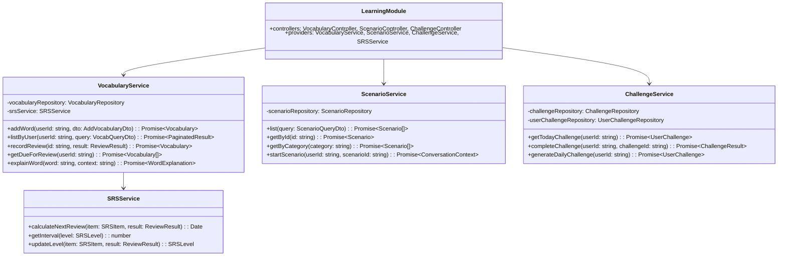

# 5.7. Learning Module

## 概要

| 項目         | 内容                                      |
| ------------ | ----------------------------------------- |
| モジュール名 | LearningModule                            |
| 責務         | 語彙管理、シナリオ、チャレンジ、復習(SRS) |
| 依存         | UserModule, CommonModule                  |
| 関連 UC      | UC-017, UC-024, UC-025, UC-026            |

---

## クラス図



---

## SRS (Spaced Repetition System) 設計

### インターバル計算

| SRS レベル | インターバル | 説明     |
| ---------- | ------------ | -------- |
| new        | 0 日         | 新規追加 |
| learning   | 1 日         | 学習中   |
| young      | 3 日         | 定着開始 |
| mature     | 7 日         | 定着     |
| mastered   | 30 日        | マスター |

### レベル遷移ロジック

```typescript
function updateLevel(current: SRSLevel, result: ReviewResult): SRSLevel {
  if (result === "correct") {
    switch (current) {
      case "new":
        return "learning";
      case "learning":
        return "young";
      case "young":
        return "mature";
      case "mature":
        return "mastered";
      case "mastered":
        return "mastered";
    }
  } else {
    // 不正解の場合は1レベル下げる
    switch (current) {
      case "mastered":
        return "mature";
      case "mature":
        return "young";
      case "young":
        return "learning";
      default:
        return "learning";
    }
  }
}
```

---

## VocabularyService 詳細

### addWord()

**目的:** 語彙を単語帳に追加

**入力:**
| パラメータ | 型 | 必須 | 説明 |
| --------------- | ------ | ---- | ---------------------- |
| word | string | ○ | 単語 |
| meaning | string | ○ | 意味（日本語） |
| pronunciation | string | - | 発音記号 |
| exampleSentence | string | - | 例文 |
| conversationId | string | - | 追加元の会話 ID |

**処理フロー:**

1. 重複チェック（同一ユーザー内）
2. 発音記号が空なら自動取得
3. 語彙レコード作成（srs_level = 'new'）
4. next_review_date = 今日

---

## ChallengeService 詳細

### チャレンジタイプ

| タイプ        | 説明                    | XP 報酬 |
| ------------- | ----------------------- | ------- |
| conversation  | 会話 N 回実施           | 50      |
| vocabulary    | 語彙 N 個復習           | 30      |
| pronunciation | 発音スコア N 以上を達成 | 40      |
| streak        | 連続学習 N 日達成       | 100     |
| time          | N 分以上会話            | 60      |

### generateDailyChallenge()

**目的:** ユーザーに合ったデイリーチャレンジを生成

**選択アルゴリズム:**

1. ユーザーの過去 30 日の活動パターンを分析
2. 弱点領域を特定（会話頻度、復習率など）
3. 弱点補強型 50%、バランス型 30%、得意伸ばし型 20%の確率で選択
4. 難易度はユーザーレベルに応じて調整

---

← [Feedback Module](./feedback-module.md) | _次: [Gamification Module](./gamification-module.md)_
