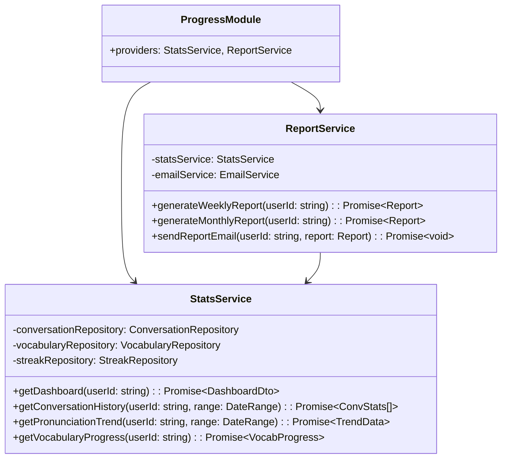

# 5.9. Progress Module

## 概要

| 項目         | 内容                                                   |
| ------------ | ------------------------------------------------------ |
| モジュール名 | ProgressModule                                         |
| 責務         | 統計収集、ダッシュボード、レポート生成                 |
| 依存         | ConversationModule, LearningModule, GamificationModule |
| 関連 UC      | UC-021, UC-022, UC-023                                 |

---

## クラス図



---

## StatsService メソッド詳細

### getDashboard()

**目的:** ユーザーのダッシュボード統計を取得

**出力:**

```typescript
interface DashboardDto {
  streak: {
    current: number;
    longest: number;
    freezeRemaining: number;
  };
  xp: {
    total: number;
    thisWeek: number;
    level: number;
    nextLevelXP: number;
  };
  conversations: {
    total: number;
    thisWeek: number;
    averageDuration: number;
  };
  pronunciation: {
    averageScore: number;
    trend: "up" | "down" | "stable";
  };
  vocabulary: {
    totalWords: number;
    dueForReview: number;
  };
  badges: {
    total: number;
    recent: Badge[];
  };
}
```

### getPronunciationTrend()

**目的:** 発音スコアのトレンドを計算

**計算ロジック:**

```
1. 指定期間の会話を取得
2. 発音スコアの平均を週/日単位で集計
3. 線形回帰でトレンドを計算
4. 傾きに基づいて up/down/stable を判定
```

---

## ReportService メソッド詳細

### generateWeeklyReport()

**レポート内容:**

- 週間会話数と総時間
- 発音スコア平均とトレンド
- 獲得 XP とレベル進捗
- ストリーク状況
- 復習した語彙数
- 獲得バッジ

---

← [Gamification Module](./gamification-module.md) | _次: [Social Module](./social-module.md)_
