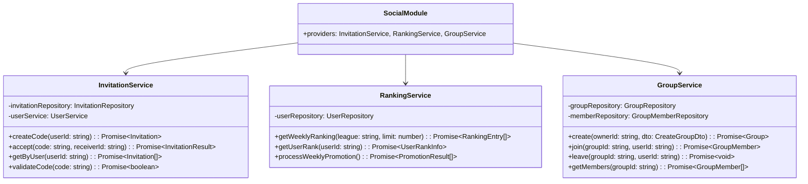

# 5.10. Social Module

## 概要

| 項目         | 内容                           |
| ------------ | ------------------------------ |
| モジュール名 | SocialModule                   |
| 責務         | 招待、ランキング、グループ管理 |
| 依存         | UserModule, GamificationModule |
| 関連 UC      | UC-027, UC-028, UC-029         |

---

## クラス図

---

## InvitationService メソッド詳細

### createCode()

**目的:** 一意の招待コードを生成

**処理フロー:**

1. 8 文字のランダムコード生成 (英数字)
2. 重複チェック
3. 招待レコード作成 (status: pending)
4. コード返却

**ビジネスルール:**

- 1 ユーザーあたり有効な招待コードは 5 個まで
- コードの有効期限は 30 日
- 招待成功時、送信者と受信者に 50XP ボーナス

### accept()

**処理フロー:**

1. コードの有効性確認
2. 既に使用済みでないか確認
3. 自己招待でないか確認
4. 招待レコード更新 (status: accepted)
5. 両者に XP ボーナス付与
6. 結果返却

---

## RankingService メソッド詳細

### getWeeklyRanking()

**処理フロー:**

1. 現在の週番号を計算
2. 指定リーグのユーザーを週間 XP 順でソート
3. 順位を付与して返却

### processWeeklyPromotion()

**バッチ処理 (月曜 00:00 UTC):**

1. 各リーグの Top 10 を昇格
2. 各リーグの Bottom 10 を降格
3. 通知送信
4. リーグ更新

---

← [Progress Module](./progress-module.md) | _次: [Subscription Module](./subscription-module.md)_
