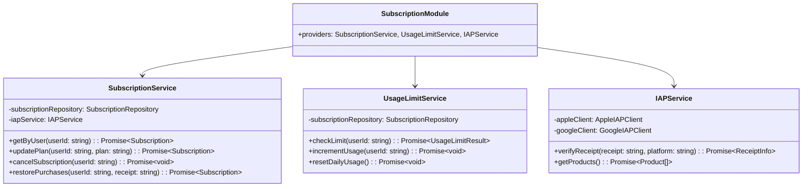

# 5.11. Subscription Module

## 概要

| 項目         | 内容                           |
| ------------ | ------------------------------ |
| モジュール名 | SubscriptionModule             |
| 責務         | プラン管理、利用制限、IAP 連携 |
| 依存         | UserModule, CommonModule       |
| 関連 UC      | UC-014, UC-015, UC-016         |

---

## クラス図



---

## プラン定義

| プラン       | 価格/月 | 会話制限 | ペルソナ | 詳細分析 |
| ------------ | ------- | -------- | -------- | -------- |
| Free         | ¥0      | 3 回/日  | 1        | ✗        |
| Premium      | ¥980    | 無制限   | 5        | ✗        |
| Premium Plus | ¥1,980  | 無制限   | 5        | ✅       |

---

## UsageLimitService メソッド詳細

### checkLimit()

**目的:** ユーザーの利用制限をチェック

**処理フロー:**

1. ユーザーのサブスクリプションを取得
2. 日付が変わっていたらカウントリセット
3. 現在の利用回数と制限を比較
4. 結果返却

**出力:**

```typescript
interface UsageLimitResult {
  canUse: boolean;
  currentCount: number;
  limit: number;
  resetAt: Date;
}
```

### resetDailyUsage()

**バッチ処理 (毎日 00:00 JST):**

1. 全ユーザーの daily_usage_count を 0 にリセット
2. last_reset_date を更新

---

## IAPService メソッド詳細

### verifyReceipt()

**目的:** App Store / Play Store のレシート検証

**Apple フロー:**

1. レシートを Apple 検証サーバーに送信
2. レスポンスのステータス確認
3. latest_receipt_info から有効期限を取得

**Google フロー:**

1. Google API でサブスクリプション状態を取得
2. expiryTimeMillis を確認

---

← [Social Module](./social-module.md) | _次: [Common Module](./common-module.md)_
