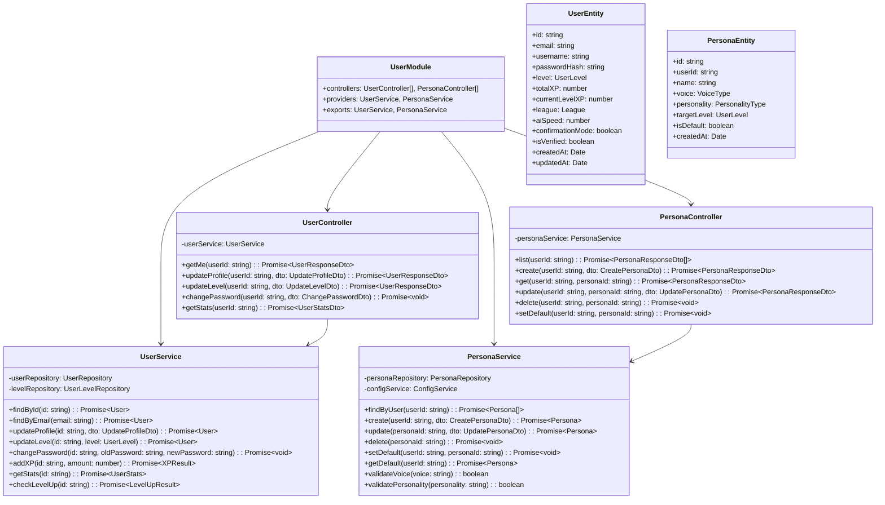

# 5.4. User Module

## 概要

| 項目         | 内容                                         |
| ------------ | -------------------------------------------- |
| モジュール名 | UserModule                                   |
| 責務         | ユーザー管理、プロフィール、ペルソナ、レベル |
| 依存         | AuthModule, CommonModule                     |
| 関連 UC      | UC-007, UC-008                               |

---

## クラス図



---

## UserService メソッド詳細

### addXP()

**目的:** ユーザーの XP を加算し、レベルアップ判定

**処理フロー:**

1. 現在の XP を取得
2. 加算 XP を追加
3. レベルアップ判定
4. レベルアップの場合:
   - レベルを更新
   - current_level_xp をリセット
   - バッジ獲得判定
   - 通知送信
5. 更新結果を返却

**レベルアップ閾値:**

| レベル | 必要 XP | 累計 XP |
| ------ | ------- | ------- |
| 1      | 0       | 0       |
| 2      | 100     | 100     |
| 3      | 200     | 300     |
| 4      | 400     | 700     |
| 5      | 800     | 1,500   |
| 6      | 1,600   | 3,100   |
| 7      | 3,200   | 6,300   |
| 8      | 6,400   | 12,700  |
| 9      | 12,800  | 25,500  |
| 10     | 25,600  | 51,100  |

**Pseudocode:**

```
function addXP(userId, amount):
    user = findById(userId)
    user.totalXP += amount
    user.currentLevelXP += amount

    levelUpResult = null
    while user.currentLevelXP >= getXPForNextLevel(user.level):
        user.currentLevelXP -= getXPForNextLevel(user.level)
        user.level += 1
        levelUpResult = { newLevel: user.level }
        checkAndAwardBadge(userId, "LEVEL_" + user.level)

    save(user)

    if levelUpResult:
        sendNotification(userId, "LEVEL_UP", levelUpResult)

    return { totalXP: user.totalXP, currentLevelXP: user.currentLevelXP, levelUp: levelUpResult }
```

---

## PersonaService メソッド詳細

### create()

**目的:** 新規ペルソナ作成

**ビジネスルール:**

- 1 ユーザーあたり最大 5 ペルソナ
- 名前はユーザー内でユニーク
- Free プランはデフォルトペルソナのみ編集可

**入力:**
| パラメータ | 型 | 必須 | バリデーション |
| ----------- | ------ | ---- | ------------------------------------------ |
| name | string | ○ | 1-50 文字、ユーザー内ユニーク |
| voice | string | ○ | voice_1, voice_2, voice_3 |
| personality | string | ○ | cheerful, strict, sarcastic |
| targetLevel | string | ○ | Beginner, Basic, Intermediate, Advanced |

**例外:**
| 例外 | 条件 | HTTP ステータス |
| -------------------------- | ---------------------- | -------------- |
| MaxPersonasReachedException | ペルソナ 5 個超過 | 400 |
| DuplicateNameException | 名前重複 | 409 |
| PremiumRequiredException | Free プランで作成試行 | 403 |

---

## 列挙型定義

### UserLevel

```typescript
enum UserLevel {
  Beginner = "Beginner",
  Basic = "Basic",
  Intermediate = "Intermediate",
  Advanced = "Advanced",
}
```

### League

```typescript
enum League {
  Bronze = "Bronze",
  Silver = "Silver",
  Gold = "Gold",
  Platinum = "Platinum",
  Diamond = "Diamond",
}
```

### VoiceType

```typescript
enum VoiceType {
  Voice1 = "voice_1", // 女性、明るい
  Voice2 = "voice_2", // 男性、落ち着き
  Voice3 = "voice_3", // 中性、フレンドリー
}
```

### PersonalityType

```typescript
enum PersonalityType {
  Cheerful = "cheerful", // 明るく励ます
  Strict = "strict", // 厳しく指導
  Sarcastic = "sarcastic", // 皮肉交じり
}
```

---

← [Auth Module](./auth-module.md) | _次: [Conversation Module](./conversation-module.md)_
