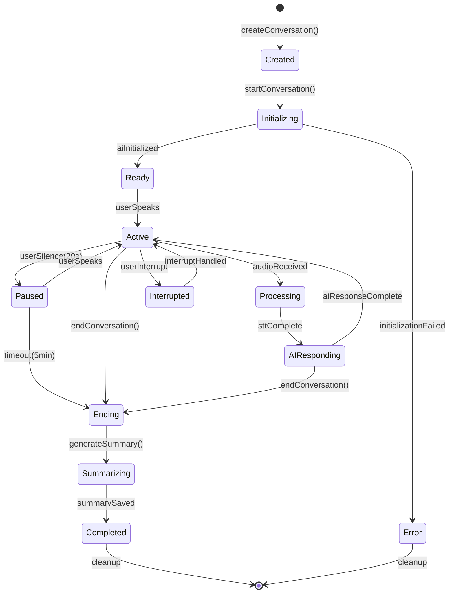
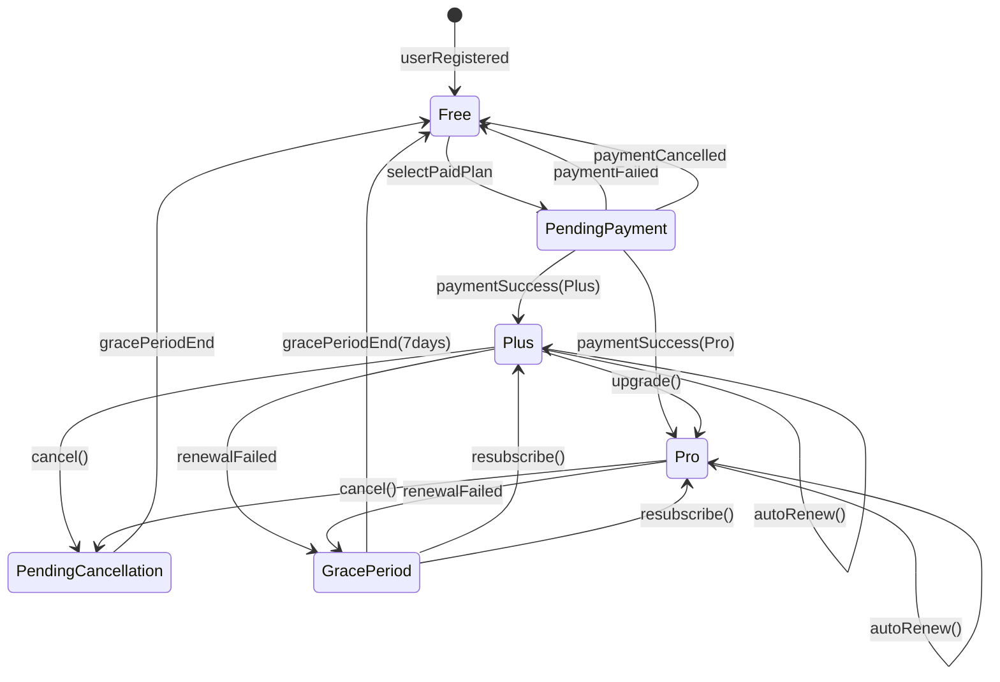
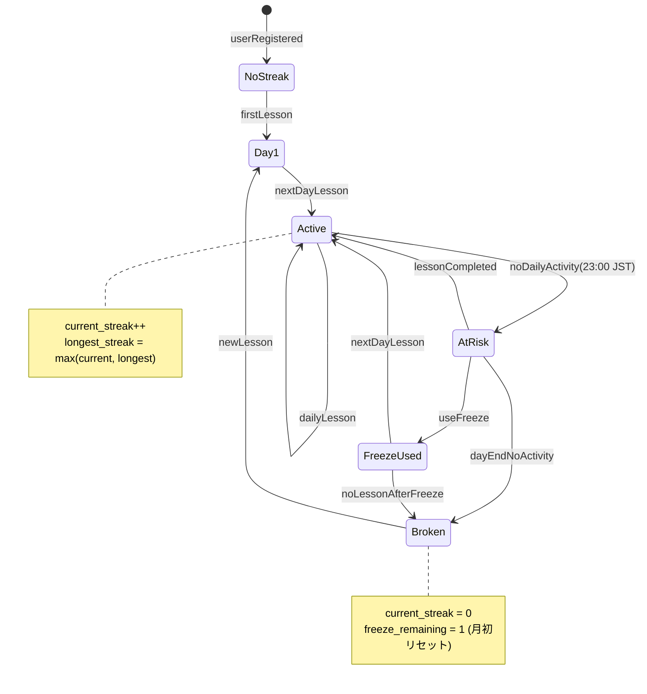

# 6. コンポーネント設計 - 共通仕様

> 📌 **ENHANCED**: State machines, algorithms, unit tests, transaction patterns

---

## 6.1. State Diagrams (Lifecycle Entities)

### 6.1.1. Conversation Session State Machine



#### 状態定義テーブル

| 状態 (State) | 説明                  | 許可操作                  | タイムアウト   |
| ------------ | --------------------- | ------------------------- | -------------- |
| Created      | 会話作成済み、未開始  | start, delete             | 10 分で削除    |
| Initializing | AI/WebSocket 初期化中 | cancel                    | 30 秒で Error  |
| Ready        | 入力待ち              | sendAudio, end            | 5 分で Paused  |
| Active       | 会話進行中            | sendAudio, interrupt, end | 20 秒で Paused |
| Processing   | 音声処理中            | interrupt                 | 60 秒で Error  |
| AIResponding | AI 応答生成中         | interrupt, end            | 30 秒で Error  |
| Paused       | 一時停止              | resume, end               | 5 分で Ending  |
| Interrupted  | 割り込み処理中        | wait                      | 1 秒で Active  |
| Ending       | 終了処理中            | wait                      | -              |
| Summarizing  | サマリー生成中        | wait                      | 30 秒で Error  |
| Completed    | 完了                  | getResult                 | -              |
| Error        | エラー状態            | retry, cleanup            | -              |

---

### 6.1.2. Subscription State Machine



#### 状態遷移ルール

| 現在状態            | イベント       | 次状態              | アクション                 |
| ------------------- | -------------- | ------------------- | -------------------------- |
| Free                | selectPaidPlan | PendingPayment      | IAP 決済画面表示           |
| PendingPayment      | paymentSuccess | Plus/Pro            | プラン有効化、Receipt 保存 |
| Plus                | upgrade        | Pro                 | 即座に Pro に変更          |
| Plus                | cancel         | PendingCancellation | 次回更新日まで Plus 維持   |
| Plus                | renewalFailed  | GracePeriod         | 7 日間の猶予期間開始       |
| PendingCancellation | gracePeriodEnd | Free                | Free に戻す、通知送信      |
| GracePeriod         | resubscribe    | Plus/Pro            | プラン再開、全機能復活     |

---

### 6.1.3. Streak State Machine



---

## 6.2. Algorithm Specifications

### 6.2.1. XP Calculation Algorithm

```
XP_EARNED = BASE_XP + BONUS_XP + STREAK_BONUS

WHERE:
  BASE_XP = floor(DURATION_SECONDS / 60) × 10
  BONUS_XP = max(0, (PRONUNCIATION_SCORE - 70) × 0.5)
  STREAK_BONUS = min(CURRENT_STREAK × 2, 20)

LEVEL_UP_THRESHOLD(level) = 100 × level^1.5

Example:
  Duration: 10分 (600秒), Score: 85点, Streak: 5日
  BASE_XP = floor(600/60) × 10 = 100
  BONUS_XP = (85 - 70) × 0.5 = 7.5
  STREAK_BONUS = min(5 × 2, 20) = 10
  XP_EARNED = 100 + 7.5 + 10 = 117.5 → 118 XP
```

### 6.2.2. Spaced Repetition Algorithm (SRS for Vocabulary)

```
NEXT_REVIEW_DATE = CURRENT_DATE + INTERVAL_DAYS

INTERVAL_CALCULATION:
  IF quality < 3:
    repetitions = 0
    interval = 1
    ease_factor = max(1.3, ease_factor - 0.2)
  ELSE:
    IF repetitions == 0:
      interval = 1
    ELIF repetitions == 1:
      interval = 6
    ELSE:
      interval = round(previous_interval × ease_factor)

    ease_factor = ease_factor + (0.1 - (5 - quality) × (0.08 + (5 - quality) × 0.02))
    ease_factor = max(1.3, ease_factor)
    repetitions++

QUALITY MAPPING:
  0 = Complete blackout (答えられなかった)
  1 = Incorrect (間違った回答)
  2 = Correct with difficulty (ヒント後正答)
  3 = Correct with hesitation (やや時間要)
  4 = Correct (正答)
  5 = Perfect (即答)
```

### 6.2.3. Weekly Ranking Score Algorithm

```
WEEKLY_SCORE = XP_POINTS + STREAK_BONUS + ACTIVITY_MULTIPLIER

WHERE:
  XP_POINTS = total XP earned this week
  STREAK_BONUS = current_streak × 50 (max 350)
  ACTIVITY_MULTIPLIER:
    - 7 days active: × 1.2
    - 5-6 days: × 1.1
    - 3-4 days: × 1.0
    - 1-2 days: × 0.9

TIE_BREAKER:
  1. Total conversation minutes
  2. Pronunciation score average
  3. Registration date (older wins)
```

---

## 6.3. Unit Test Specifications

### 6.3.1. ConversationService Tests

| Test ID   | Test Name                | Input                           | Expected Output          | Mocks            |
| --------- | ------------------------ | ------------------------------- | ------------------------ | ---------------- |
| CONV-T001 | 会話作成：正常系         | validUserId, mode=instructor    | Conversation with ID     | Repository       |
| CONV-T002 | 会話作成：利用制限超過   | freeUser, 4th conversation/day  | UsageLimitException      | SubscriptionRepo |
| CONV-T003 | 会話終了：サマリー生成   | activeConversation with 5 turns | Summary + 50 XP          | LLMService       |
| CONV-T004 | 会話終了：二重終了防止   | already ended conversation      | BusinessException        | -                |
| CONV-T005 | 音声処理：ストリーミング | valid audio chunks (10)         | transcript + ai_response | STT, TTS, LLM    |
| CONV-T006 | 割り込み処理：AI 応答中  | interrupt while AIResponding    | processing_stopped       | -                |
| CONV-T007 | タイムアウト：無反応     | no activity for 5 min           | session paused/ended     | -                |

```typescript
// Example Test: CONV-T001 会話作成：正常系
describe("ConversationService", () => {
  describe("create", () => {
    it("should create conversation with valid input", async () => {
      // Arrange
      const dto = {
        mode: ConversationMode.INSTRUCTOR,
        personaId: "persona-123",
      };
      const userId = "user-123";

      mockSubscriptionService.checkDailyLimit.mockResolvedValue(true);
      mockConversationRepository.create.mockResolvedValue({
        id: "conv-456",
        userId,
        ...dto,
        status: "created",
      });

      // Act
      const result = await service.create(userId, dto);

      // Assert
      expect(result.id).toBeDefined();
      expect(result.mode).toBe(ConversationMode.INSTRUCTOR);
      expect(mockConversationRepository.create).toHaveBeenCalledOnce();
    });
  });
});
```

---

### 6.3.2. UserService Tests

| Test ID   | Test Name                 | Input                    | Expected Output         | Mocks               |
| --------- | ------------------------- | ------------------------ | ----------------------- | ------------------- |
| USER-T001 | プロフィール取得          | validUserId              | UserProfile             | UserRepository      |
| USER-T002 | プロフィール更新          | userId, updateDto        | Updated Profile         | UserRepository      |
| USER-T003 | XP 追加：レベルアップなし | userId, xp=50            | {newXP, levelUp: false} | -                   |
| USER-T004 | XP 追加：レベルアップあり | userId, xp=100 (閾値超)  | {newXP, levelUp: true}  | NotificationService |
| USER-T005 | ペルソナ作成              | userId, personaDto       | Persona                 | PersonaRepository   |
| USER-T006 | ペルソナ削除：デフォルト  | userId, defaultPersonaId | BusinessException       | -                   |

---

### 6.3.3. GamificationService Tests

| Test ID  | Test Name                | Input                         | Expected Output      | Mocks      |
| -------- | ------------------------ | ----------------------------- | -------------------- | ---------- |
| GAM-T001 | ストリーク更新：継続     | userId with 5-day streak      | streak = 6           | StreakRepo |
| GAM-T002 | ストリーク更新：リセット | userId, last activity 2d ago  | streak = 1           | StreakRepo |
| GAM-T003 | ストリークフリーズ使用   | userId with freeze available  | freeze used, streak+ | StreakRepo |
| GAM-T004 | バッジ付与：条件達成     | userId, conversation_count=10 | CONVERSATIONS_10     | BadgeRepo  |
| GAM-T005 | ランキング計算           | weekStartDate                 | Ranked users list    | UserRepo   |

---

## 6.4. Transaction Patterns

### 6.4.1. Transaction Isolation Levels

| 操作                   | Isolation Level | 理由                       |
| ---------------------- | --------------- | -------------------------- |
| 会話作成               | READ COMMITTED  | 低競合、パフォーマンス優先 |
| XP 追加・レベルアップ  | REPEATABLE READ | 二重付与防止               |
| サブスクリプション変更 | SERIALIZABLE    | 決済整合性必須             |
| ストリーク更新         | REPEATABLE READ | 日次処理での競合防止       |
| ランキング集計         | READ COMMITTED  | スナップショット許容       |

### 6.4.2. Distributed Lock Pattern

```typescript
// Redis-based distributed lock for subscription changes
async function withDistributedLock<T>(
  key: string,
  ttlMs: number,
  operation: () => Promise<T>
): Promise<T> {
  const lockKey = `lock:${key}`;
  const lockValue = generateUUID();

  // Try to acquire lock
  const acquired = await redis.set(lockKey, lockValue, "PX", ttlMs, "NX");

  if (!acquired) {
    throw new ConcurrencyException("Resource locked");
  }

  try {
    return await operation();
  } finally {
    // Release lock with Lua script (atomic check-and-delete)
    await redis.eval(
      `
      if redis.call("get", KEYS[1]) == ARGV[1] then
        return redis.call("del", KEYS[1])
      else
        return 0
      end
    `,
      1,
      lockKey,
      lockValue
    );
  }
}
```

---

## 6.5. Mock Objects Definition

| Mock Object             | Purpose                | Methods                       |
| ----------------------- | ---------------------- | ----------------------------- |
| MockSTTService          | STT streaming mock     | streamTranscribe()            |
| MockLLMService          | LLM response mock      | generateResponse(), analyze() |
| MockTTSService          | TTS streaming mock     | streamSynthesize()            |
| MockIAPService          | In-App Purchase mock   | verifyReceipt()               |
| MockNotificationService | Push notification mock | send(), schedule()            |
| MockCacheService        | Redis cache mock       | get(), set(), del()           |

```typescript
// Example: MockSTTService
export class MockSTTService implements ISTTService {
  private mockTranscripts: string[] = [];

  setMockTranscripts(transcripts: string[]): void {
    this.mockTranscripts = transcripts;
  }

  async *streamTranscribe(audio: Buffer): AsyncGenerator<TranscriptResult> {
    for (const text of this.mockTranscripts) {
      yield { text, isFinal: false, confidence: 0.95 };
      await delay(100);
    }
    yield {
      text: this.mockTranscripts.join(" "),
      isFinal: true,
      confidence: 0.98,
    };
  }
}
```

---

_メインファイル: [../06-component-design.md](../06-component-design.md)_
