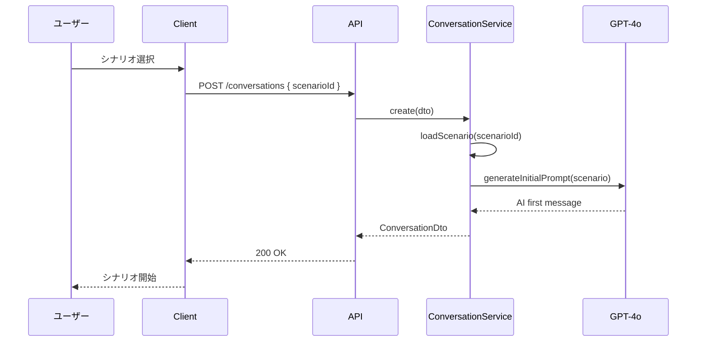

# 6.11. Advanced Use Cases (UC-030 ～ UC-032)

## UC-030: 発音詳細分析

> Premium Plus 限定機能

### 分析項目

| 項目       | スコア範囲 | 説明         |
| ---------- | ---------- | ------------ |
| accuracy   | 0-100      | 発音の正確さ |
| fluency    | 0-100      | 流暢さ       |
| intonation | 0-100      | 抑揚の自然さ |
| stress     | 0-100      | 強勢の正確さ |

### 音素レベル分析

各音素（phoneme）について:

- 正確さスコア
- 問題のある発音のフィードバック
- 改善のための発音ガイド

---

## UC-031: ロールプレイモード

### シナリオ構成

| 要素       | 説明                 |
| ---------- | -------------------- |
| situation  | シチュエーション説明 |
| userRole   | ユーザーの役割       |
| aiRole     | AI の役割            |
| objectives | 達成目標リスト       |
| keyPhrases | 使うべきキーフレーズ |

### シーケンス図

---

## UC-032: TOEIC/IELTS 対策

### テスト形式シナリオ

| テスト | サポート形式      |
| ------ | ----------------- |
| TOEIC  | Speaking Part 1-4 |
| IELTS  | Speaking Part 1-3 |

### スコア推定

テスト形式に基づいて推定スコアを計算:

- 発音 (40%)
- 文法 (30%)
- 語彙 (20%)
- 流暢さ (10%)

---

← [Social UCs](./social-01.md) | _次: [Batch Processing](./batch-01.md)_
