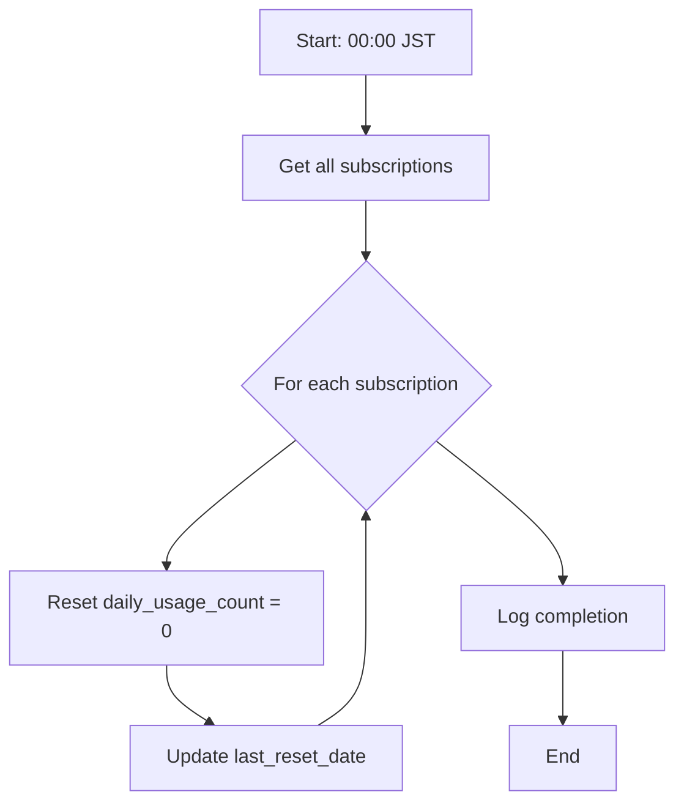
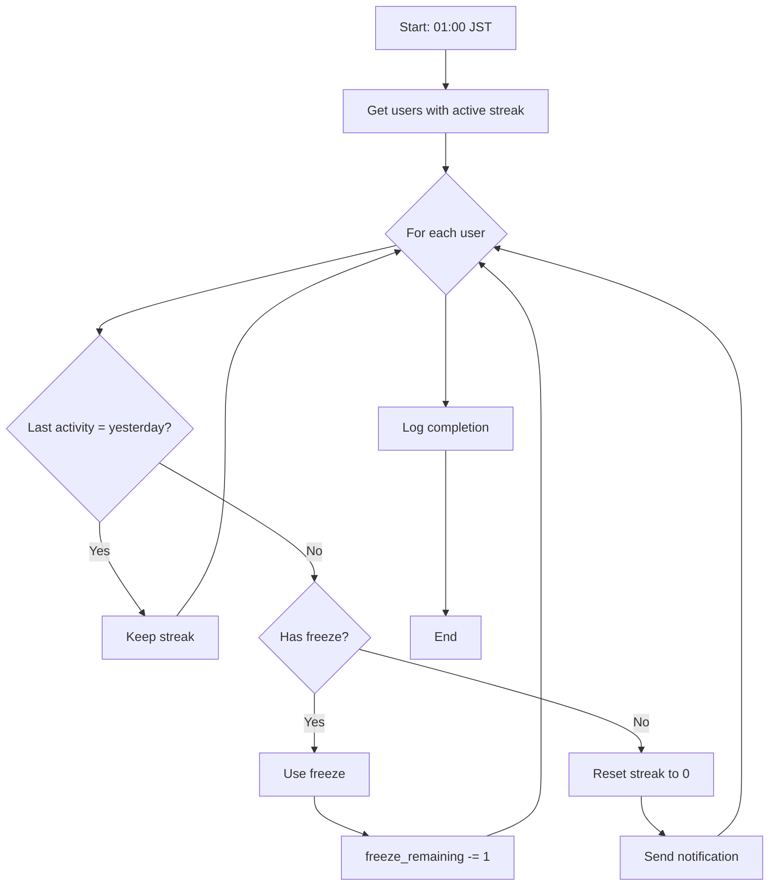
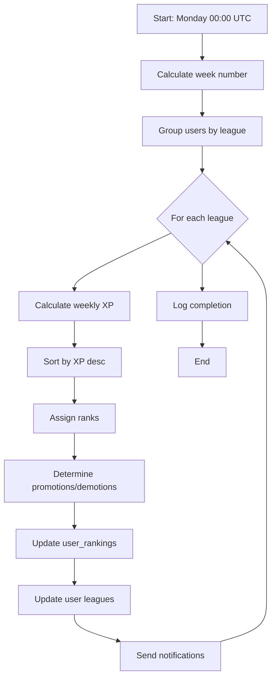

# 6.12. Batch Processing (BAT-001 ～ BAT-008)

## バッチ処理一覧

| BAT ID  | バッチ名           | 実行タイミング      | 対象             |
| ------- | ------------------ | ------------------- | ---------------- |
| BAT-001 | 日次利用量リセット | 毎日 00:00 JST      | subscriptions    |
| BAT-002 | ストリークチェック | 毎日 01:00 JST      | streaks          |
| BAT-003 | 週間ランキング集計 | 毎週月曜 00:00 UTC  | user_rankings    |
| BAT-004 | 週間レポート生成   | 毎週月曜 06:00 JST  | users + reports  |
| BAT-005 | 月間レポート生成   | 毎月 1 日 06:00 JST | users + reports  |
| BAT-006 | 期限切れデータ削除 | 毎日 03:00 JST      | 各テーブル       |
| BAT-007 | チャレンジ生成     | 毎日 00:00 JST      | user_challenges  |
| BAT-008 | パーティション管理 | 毎月 1 日 00:00 JST | conversations 等 |

---

## BAT-001: 日次利用量リセット

### Flowchart



### Pseudocode

```typescript
async function resetDailyUsage(): Promise<BatchResult> {
  const startTime = Date.now();

  try {
    const result = await prisma.subscription.updateMany({
      data: {
        daily_usage_count: 0,
        last_reset_date: new Date(),
      },
    });

    logger.info("Daily usage reset completed", {
      affectedRows: result.count,
      duration: Date.now() - startTime,
    });

    return { success: true, affectedRows: result.count };
  } catch (error) {
    logger.error("Daily usage reset failed", { error });
    throw error;
  }
}
```

### SQL

```sql
UPDATE subscriptions
SET daily_usage_count = 0,
    last_reset_date = CURRENT_DATE,
    updated_at = CURRENT_TIMESTAMP;
```

---

## BAT-002: ストリークチェック

### Flowchart



### Pseudocode

```typescript
async function checkStreaks(): Promise<BatchResult> {
  const yesterday = getYesterday();
  const today = getToday();

  // 1. 昨日活動がなく、今日もまだ活動していないユーザーを取得
  const atRiskStreaks = await prisma.streak.findMany({
    where: {
      current_streak: { gt: 0 },
      last_activity_date: { lt: yesterday },
    },
    include: { user: true },
  });

  let resetCount = 0;
  let freezeUsedCount = 0;

  for (const streak of atRiskStreaks) {
    if (streak.freeze_remaining > 0) {
      // フリーズを使用
      await prisma.streak.update({
        where: { id: streak.id },
        data: { freeze_remaining: streak.freeze_remaining - 1 },
      });
      freezeUsedCount++;
    } else {
      // ストリークをリセット
      await prisma.streak.update({
        where: { id: streak.id },
        data: { current_streak: 0 },
      });
      resetCount++;

      // 通知送信
      await notificationService.send(streak.userId, {
        type: "STREAK_LOST",
        data: { previousStreak: streak.current_streak },
      });
    }
  }

  logger.info("Streak check completed", { resetCount, freezeUsedCount });
  return { success: true, resetCount, freezeUsedCount };
}
```

---

## BAT-003: 週間ランキング集計

### Flowchart



### Pseudocode

```typescript
async function processWeeklyRanking(): Promise<BatchResult> {
  const lastWeek = getLastWeekNumber();
  const thisWeek = getWeekNumber();
  const year = new Date().getFullYear();

  const leagues = ["Bronze", "Silver", "Gold", "Platinum", "Diamond"];

  for (const league of leagues) {
    // 1. リーグ内のユーザーを週間XP順で取得
    const users = await prisma.user.findMany({
      where: { league },
      orderBy: { weeklyXp: "desc" },
    });

    // 2. ランキングレコード作成
    const rankings = users.map((user, index) => ({
      userId: user.id,
      weekNumber: lastWeek,
      year,
      league,
      weeklyXp: user.weeklyXp,
      rank: index + 1,
    }));

    await prisma.userRanking.createMany({ data: rankings });

    // 3. 昇格処理 (Top 10)
    const promotedUsers = users.slice(0, 10);
    const nextLeague = getNextLeague(league);
    if (nextLeague) {
      for (const user of promotedUsers) {
        await prisma.user.update({
          where: { id: user.id },
          data: { league: nextLeague },
        });
        await notificationService.send(user.id, {
          type: "LEAGUE_PROMOTED",
          data: { from: league, to: nextLeague },
        });
      }
    }

    // 4. 降格処理 (Bottom 10)
    const demotedUsers = users.slice(-10);
    const prevLeague = getPrevLeague(league);
    if (prevLeague) {
      for (const user of demotedUsers) {
        await prisma.user.update({
          where: { id: user.id },
          data: { league: prevLeague },
        });
        await notificationService.send(user.id, {
          type: "LEAGUE_DEMOTED",
          data: { from: league, to: prevLeague },
        });
      }
    }

    // 5. 週間XPリセット
    await prisma.user.updateMany({
      where: { league },
      data: { weeklyXp: 0 },
    });
  }

  return { success: true };
}
```

---

## BAT-006: 期限切れデータ削除

### 対象テーブルと保持期間

| テーブル           | 保持期間 | 削除条件                       |
| ------------------ | -------- | ------------------------------ |
| conversation_turns | 6 ヶ月   | conversation.ended_at < 6M     |
| corrections        | 6 ヶ月   | 親ターンと同時削除             |
| invitations        | 30 日    | status=used かつ used_at < 30D |
| notifications      | 90 日    | created_at < 90D               |

### SQL

```sql
-- conversation_turns (パーティション drop)
ALTER TABLE conversation_turns
DROP PARTITION conversation_turns_2024_07;

-- invitations
DELETE FROM invitations
WHERE status = 'used'
  AND used_at < CURRENT_DATE - INTERVAL '30 days';

-- notifications
DELETE FROM notifications
WHERE created_at < CURRENT_DATE - INTERVAL '90 days';
```

---

← [Advanced UCs](./advanced-01.md) | _戻る: [コンポーネント設計](../06-component-design.md)_
