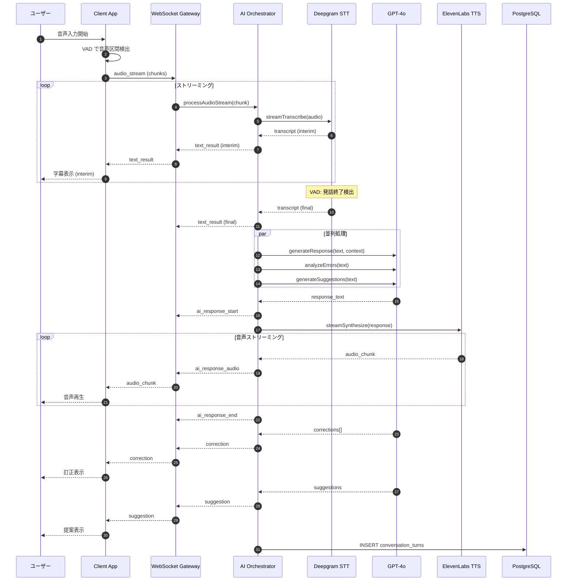
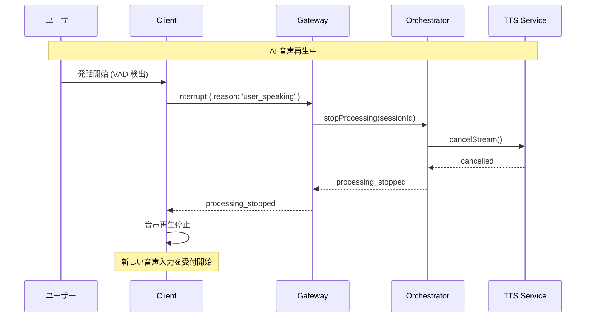
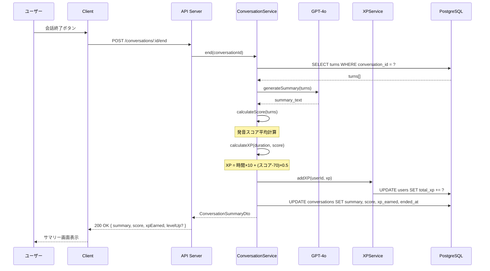

# 6.3. Conversation Use Cases (UC-001 ～ UC-010, UC-033)

## UC-003: リアルタイム会話

### 処理概要

ユーザーの音声入力をリアルタイムで処理し、AI の応答を返す。

### シーケンス図



### Pseudocode

```typescript
async function* processAudioStream(
  audio: Buffer,
  context: ConversationContext
): AsyncGenerator<AIResponse> {
  try {
    // 1. STT でテキスト変換（ストリーミング）
    for await (const transcript of sttService.streamTranscribe(audio)) {
      yield { type: "text_result", data: transcript };

      if (transcript.is_final) {
        // 2. 会話ターンを DB に保存
        await turnRepository.create({
          conversationId: context.conversationId,
          speaker: "user",
          content: transcript.text,
          sequence: context.nextSequence++,
        });

        // 3. 並列で LLM 処理開始
        const [responsePromise, errorsPromise, suggestionsPromise] = [
          generateResponse(transcript.text, context),
          analyzeErrors(transcript.text, context),
          generateSuggestions(transcript.text, context),
        ];

        // 4. 応答テキストが得られたら TTS 開始
        const responseText = await responsePromise;
        yield { type: "ai_response_start" };

        // 5. TTS ストリーミング
        for await (const audioChunk of ttsService.streamSynthesize(
          responseText,
          context.persona.voice
        )) {
          yield { type: "ai_response_audio", data: audioChunk };
        }

        yield { type: "ai_response_end" };

        // 6. AI ターンを DB に保存
        await turnRepository.create({
          conversationId: context.conversationId,
          speaker: "ai",
          content: responseText,
          sequence: context.nextSequence++,
        });

        // 7. 訂正・提案を返却
        const errors = await errorsPromise;
        if (errors.length > 0) {
          yield { type: "correction", data: errors };

          // 訂正を DB に保存
          await correctionRepository.createMany(
            errors.map((e) => ({
              turnId: userTurn.id,
              type: e.type,
              originalText: e.original,
              correctedText: e.corrected,
              explanation: e.explanation,
              severity: e.severity,
            }))
          );
        }

        const suggestions = await suggestionsPromise;
        yield { type: "suggestion", data: suggestions };
      }
    }
  } catch (error) {
    if (error instanceof ExternalServiceException) {
      yield {
        type: "error",
        data: { code: "EXT_SERVICE_ERROR", message: error.message },
      };
    } else {
      throw error;
    }
  }
}
```

### バリデーションルール

| フィールド       | 条件               | エラーメッセージ       |
| ---------------- | ------------------ | ---------------------- |
| audio chunk size | ≤ 64KB             | Audio chunk too large  |
| conversation_id  | 存在する会話 ID    | Conversation not found |
| user ownership   | 会話の所有者である | Not authorized         |
| usage limit      | 日次制限内         | Daily limit reached    |

### ビジネスルール

| Rule ID | ルール内容                                 |
| ------- | ------------------------------------------ |
| BR-001  | Free プランは 1 日 3 回まで会話可能        |
| BR-002  | 1 ターンの音声入力は最大 60 秒             |
| BR-003  | 1 会話のターン数は最大 100                 |
| BR-004  | 発話が 30 秒以上ない場合、自動タイムアウト |

---

## UC-009: 会話割り込み

### 処理概要

AI の応答中にユーザーが発話を開始した場合、AI 処理を即時停止する。

### シーケンス図



### Pseudocode

```typescript
async function stopProcessing(sessionId: string): Promise<void> {
  const session = sessionStore.get(sessionId);
  if (!session) return;

  // 1. 進行中のストリームをキャンセル
  session.currentSttStream?.cancel();
  session.currentTtsStream?.cancel();

  // 2. 進行中の LLM リクエストをキャンセル
  session.pendingLLMRequests.forEach((req) => req.abort());

  // 3. 状態をリセット
  session.state = "ready_for_input";

  // 4. クライアントに通知
  session.socket.emit("processing_stopped");

  logger.info("Processing stopped due to user interrupt", { sessionId });
}
```

---

## UC-033: 会話サマリー生成

### 処理概要

会話終了時に学習内容のサマリーを生成し、XP を付与する。

### シーケンス図



### Pseudocode

```typescript
async function endConversation(
  conversationId: string
): Promise<ConversationSummary> {
  // 1. 会話とターン取得
  const conversation = await conversationRepository.findById(conversationId);
  if (!conversation) throw new NotFoundException("Conversation not found");
  if (conversation.endedAt) throw new BusinessException("Already ended");

  const turns = await turnRepository.findByConversation(conversationId);

  // 2. 会話時間計算
  const durationSeconds = Math.floor(
    (new Date().getTime() - conversation.startedAt.getTime()) / 1000
  );

  // 3. スコア計算
  const corrections = await correctionRepository.findByConversation(
    conversationId
  );
  const userTurns = turns.filter((t) => t.speaker === "user");
  const errorRate = corrections.length / Math.max(userTurns.length, 1);
  const pronunciationScore = Math.round(100 - errorRate * 30);

  // 4. XP 計算
  const baseXP = Math.floor(durationSeconds / 60) * 10;
  const bonusXP = pronunciationScore > 70 ? (pronunciationScore - 70) * 0.5 : 0;
  const totalXP = Math.round(baseXP + bonusXP);

  // 5. サマリー生成
  const summary = await llmService.generateSummary(turns);

  // 6. XP 付与
  const xpResult = await userService.addXP(conversation.userId, totalXP);

  // 7. 会話更新
  await conversationRepository.update(conversationId, {
    endedAt: new Date(),
    durationSeconds,
    pronunciationScore,
    xpEarned: totalXP,
    summary,
  });

  // 8. ストリーク更新
  await streakService.recordActivity(conversation.userId);

  // 9. バッジチェック
  await badgeService.checkAndAward(
    conversation.userId,
    "CONVERSATION_COMPLETE"
  );

  return {
    summary,
    pronunciationScore,
    xpEarned: totalXP,
    levelUp: xpResult.levelUp,
    newBadges: xpResult.newBadges,
  };
}
```

---

← [目次](../06-component-design.md) | _次: [Feedback UCs](./feedback-01.md)_
