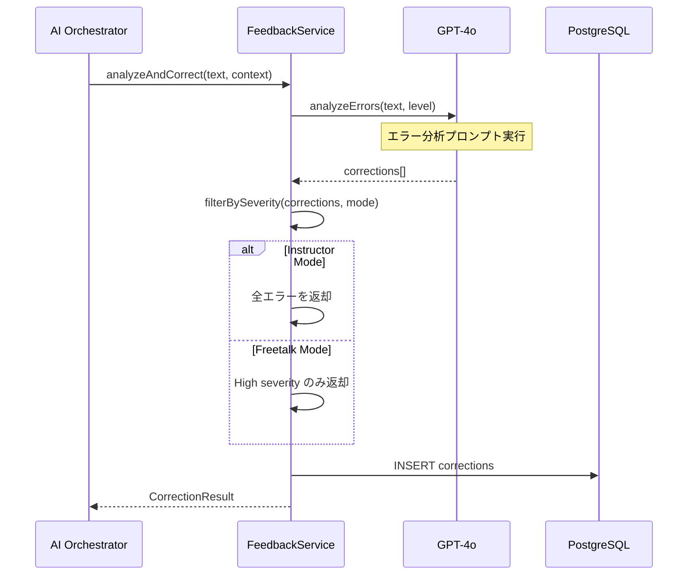

# 6.4. Feedback Use Cases (UC-004, UC-006, UC-030)

## UC-006: 即時訂正

### 処理概要

ユーザーの発話をリアルタイムで分析し、文法・語彙エラーを訂正する。

### シーケンス図



### Pseudocode

```typescript
async function analyzeAndCorrect(
  text: string,
  context: FeedbackContext
): Promise<CorrectionResult> {
  // 1. LLM でエラー分析
  const prompt = ERROR_ANALYSIS_PROMPT.replace(
    "${level}",
    context.userLevel
  ).replace("${text}", text);

  const response = await llmService.complete(prompt);
  const corrections = JSON.parse(response).corrections;

  // 2. モードに応じてフィルタリング
  const filtered =
    context.mode === "instructor"
      ? corrections
      : corrections.filter((c) => c.severity === "high");

  // 3. DB に保存
  if (context.turnId) {
    await correctionRepository.createMany(
      filtered.map((c) => ({
        turnId: context.turnId,
        type: c.type,
        originalText: c.original,
        correctedText: c.corrected,
        explanation: c.explanation,
        severity: c.severity,
      }))
    );
  }

  return {
    corrections: filtered,
    overallAccuracy: calculateAccuracy(text, corrections),
  };
}
```

### 訂正タイプ

| タイプ        | 説明           | 例                              |
| ------------- | -------------- | ------------------------------- |
| grammar       | 文法エラー     | "I go yesterday" → "I went..."  |
| vocabulary    | 語彙の選択ミス | "make a photo" → "take a photo" |
| pronunciation | 発音問題       | 音声分析から検出                |
| naturalness   | より自然な表現 | "I'm happy" → "That's great!"   |

---

## UC-030: 発音詳細分析

### 処理概要

Premium ユーザー向けに詳細な発音分析を提供する。

### Pseudocode

```typescript
async function analyzePronunciation(
  audio: Buffer,
  expectedText: string
): Promise<PronunciationScore> {
  // 1. 音声を音素レベルで分析
  const phonemes = await pronunciationEngine.getPhonemeScores(audio);

  // 2. 各スコア計算
  const accuracy = calculateAccuracy(phonemes, expectedText);
  const fluency = calculateFluency(audio);
  const intonation = calculateIntonation(audio);
  const stress = calculateStress(audio, expectedText);

  // 3. 改善点を生成
  const suggestions = generateSuggestions(phonemes);

  return {
    overall: Math.round((accuracy + fluency + intonation + stress) / 4),
    accuracy,
    fluency,
    intonation,
    stress,
    phonemes,
    suggestions,
  };
}
```

---

← [Conversation UCs](./conversation-01.md) | _次: [User UCs](./user-01.md)_
