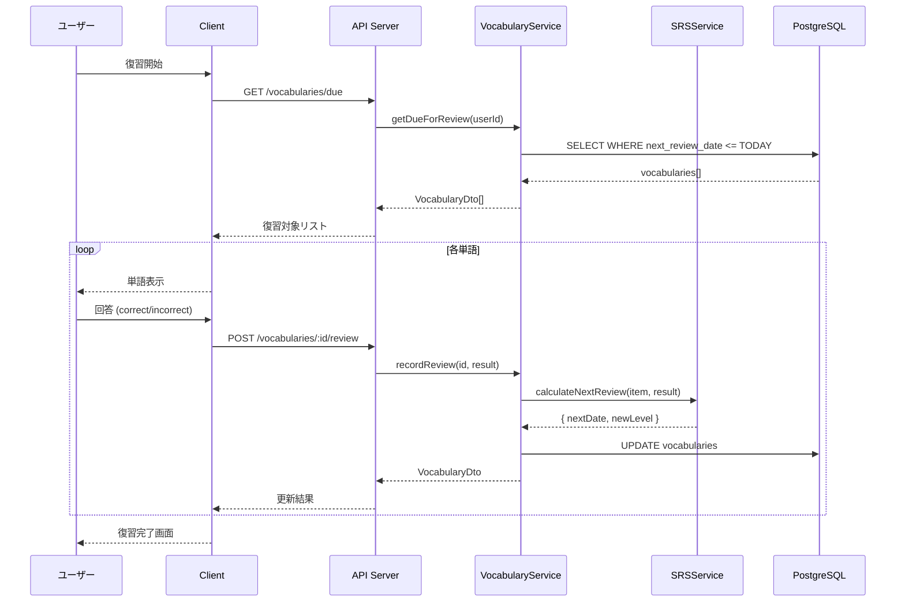
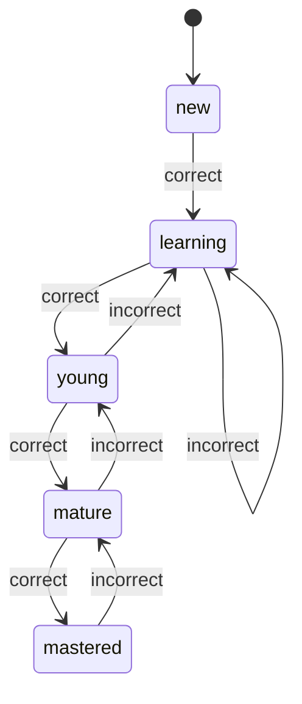

# 6.7. Learning Use Cases (UC-017, UC-024 ～ UC-026)

## UC-026: 単語帳＆復習 (SRS)

### 処理概要

Spaced Repetition System を使用して効率的な語彙学習を提供する。

### シーケンス図



### SRS レベル遷移



### Pseudocode

```typescript
function calculateNextReview(
  item: SRSItem,
  result: "correct" | "incorrect"
): SRSResult {
  const intervals: Record<SRSLevel, number> = {
    new: 0,
    learning: 1,
    young: 3,
    mature: 7,
    mastered: 30,
  };

  let newLevel: SRSLevel;

  if (result === "correct") {
    // レベルアップ
    newLevel = getNextLevel(item.srsLevel);
  } else {
    // レベルダウン（最低 learning まで）
    newLevel = getPrevLevel(item.srsLevel);
  }

  const nextReviewDate = addDays(new Date(), intervals[newLevel]);

  return { newLevel, nextReviewDate };
}
```

### バリデーションルール

| フィールド | 条件              | エラーメッセージ    |
| ---------- | ----------------- | ------------------- |
| word       | 1-100 文字        | Word length invalid |
| meaning    | 1-500 文字        | Meaning too long    |
| result     | correct/incorrect | Invalid result      |

---

## UC-025: デイリーチャレンジ

### 処理概要

毎日ユーザーに合わせたチャレンジを生成・管理する。

### チャレンジタイプ

| タイプ        | 条件                    | XP 報酬 |
| ------------- | ----------------------- | ------- |
| conversation  | 会話 N 回実施           | 50      |
| vocabulary    | 語彙 N 個復習           | 30      |
| pronunciation | 発音スコア N 以上を達成 | 40      |
| streak        | 連続学習 N 日達成       | 100     |
| time          | N 分以上会話            | 60      |

---

← [Subscription UCs](./subscription-01.md) | _次: [Gamification UCs](./gamification-01.md)_
