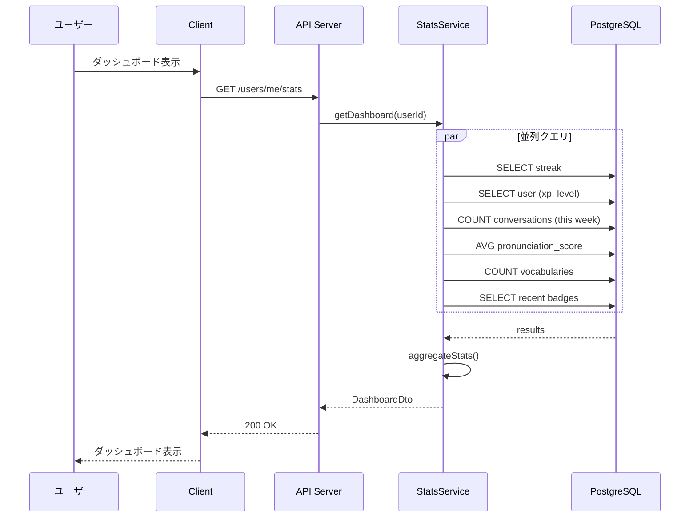

# 6.9. Progress Use Cases (UC-021 ～ UC-023)

## UC-021: 統計ダッシュボード

### 処理概要

ユーザーの学習統計をダッシュボード形式で表示する。

### シーケンス図

---

## UC-023: 週間/月間レポート

### レポート内容

| セクション | 内容                   |
| ---------- | ---------------------- |
| 学習時間   | 総会話時間、前週比     |
| 会話数     | 完了した会話数、前週比 |
| 発音スコア | 平均スコア、トレンド   |
| XP 獲得    | 獲得 XP、レベル進捗    |
| ストリーク | 現在の連続日数         |
| 語彙       | 追加数、復習数         |
| 獲得バッジ | 今週獲得したバッジ     |

---

← [Gamification UCs](./gamification-01.md) | _次: [Social UCs](./social-01.md)_
