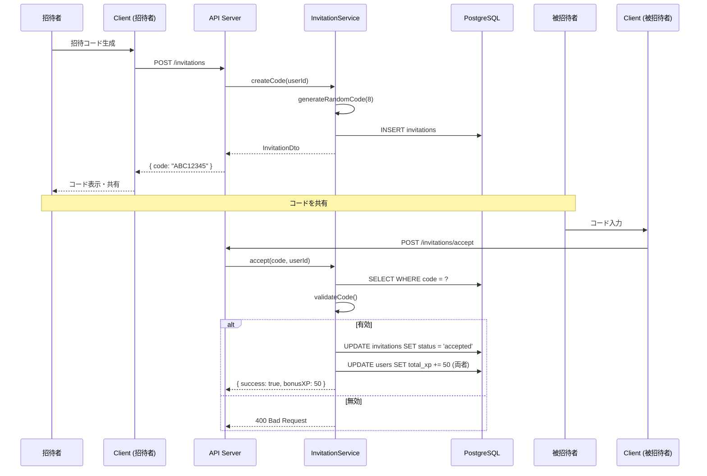

# 6.10. Social Use Cases (UC-027 ～ UC-029)

## UC-027: 友達招待

### 処理概要

招待コードを生成し、友達を招待する。

### シーケンス図

### ビジネスルール

| Rule ID | ルール内容                    |
| ------- | ----------------------------- |
| BR-027  | 1 人 5 個まで有効な招待コード |
| BR-028  | コード有効期限は 30 日        |
| BR-029  | 招待成功で両者 50XP ボーナス  |
| BR-030  | 自己招待は不可                |

---

## UC-028: 週間ランキング

### ランキング表示データ

| フィールド | 説明           |
| ---------- | -------------- |
| rank       | 順位           |
| username   | ユーザー名     |
| weeklyXP   | 今週の XP      |
| change     | 前週からの変動 |

---

← [Progress UCs](./progress-01.md) | _次: [Advanced UCs](./advanced-01.md)_
