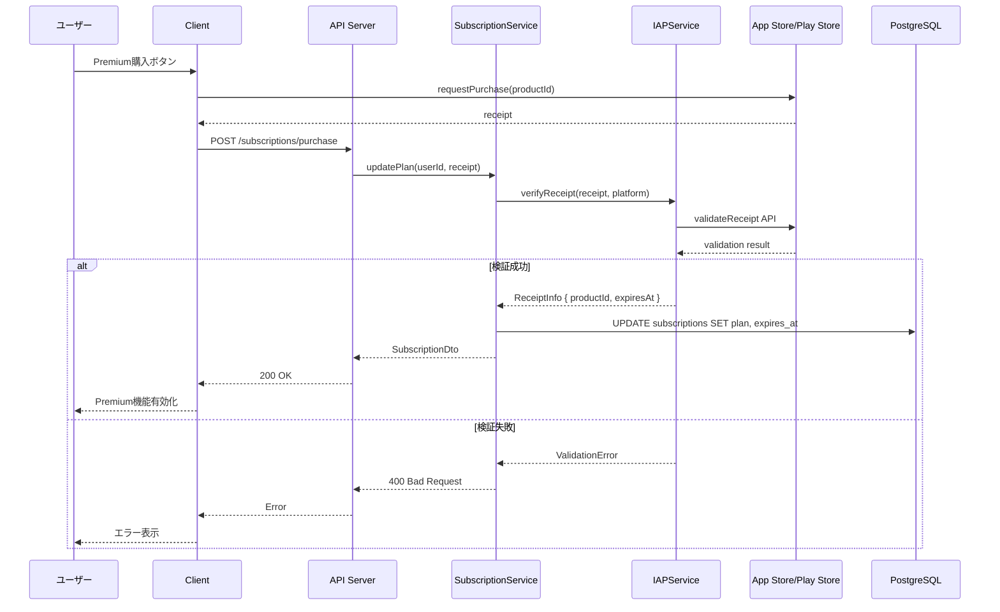

# 6.6. Subscription Use Cases (UC-014 ～ UC-016)

## UC-016: プラン変更

### 処理概要

App Store/Play Store の IAP を通じてサブスクリプションを購入・更新する。

### シーケンス図



### Pseudocode

```typescript
async function updatePlan(
  userId: string,
  receipt: string,
  platform: "ios" | "android"
): Promise<SubscriptionDto> {
  // 1. レシート検証
  const receiptInfo = await iapService.verifyReceipt(receipt, platform);

  if (!receiptInfo.isValid) {
    throw new BusinessException("Invalid receipt");
  }

  // 2. プラン決定
  const plan = mapProductToPlan(receiptInfo.productId);

  // 3. サブスクリプション更新
  const subscription = await prisma.subscription.update({
    where: { userId },
    data: {
      plan,
      dailyUsageLimit: plan === "free" ? 3 : 9999,
      expiresAt: new Date(receiptInfo.expiresAt),
    },
  });

  // 4. バッジ付与
  if (plan !== "free") {
    await badgeService.checkAndAward(userId, "FIRST_PREMIUM");
  }

  logger.info("Subscription updated", { userId, plan });

  return SubscriptionDto.fromEntity(subscription);
}
```

### ビジネスルール

| Rule ID | ルール内容                                         |
| ------- | -------------------------------------------------- |
| BR-016  | サブスクリプションは App Store/Play Store 経由のみ |
| BR-017  | 解約後も期限まで Premium 機能を利用可能            |
| BR-018  | プラン変更は即時反映                               |

---

← [User UCs](./user-01.md) | _次: [Learning UCs](./learning-01.md)_
