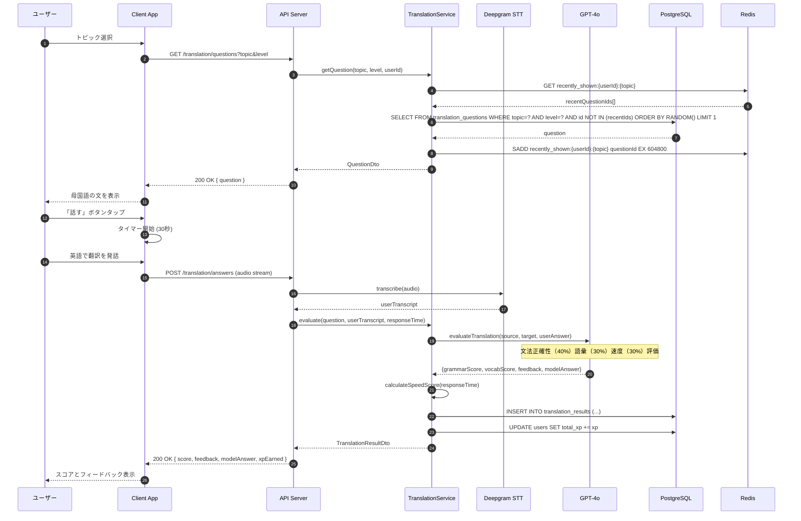
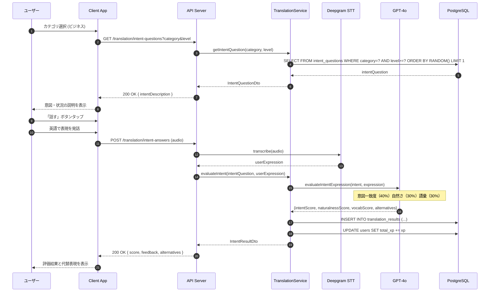

# 6.12. Translation Practice Use Cases (UC-034 ～ UC-038)

> このファイルは翻訳練習機能（FR-034〜FR-038）に関するコンポーネント設計を定義します。

---

## UC-034: ダイレクト翻訳練習

### 処理概要

選択したトピックと学習者のレベルに応じて、母国語の文を表示し、学習者が英語で口頭翻訳する。AI が文法、語彙、応答速度を基に採点する。

### シーケンス図



### Pseudocode

```typescript
async function getTranslationQuestion(
  userId: string,
  topic: string,
  level: UserLevel
): Promise<TranslationQuestion> {
  // 1. 最近出題された問題IDを取得（過去7日間）
  const recentIds = await cache.smembers(`recently_shown:${userId}:${topic}`);

  // 2. 未出題の問題を取得
  let question = await translationQuestionRepository.findOne(
    {
      topic,
      level,
      isActive: true,
      id: Not(In(recentIds)),
    },
    { order: { RANDOM: "DESC" } }
  );

  // 3. 全問出題済みの場合、履歴をリセット
  if (!question) {
    await cache.del(`recently_shown:${userId}:${topic}`);
    question = await translationQuestionRepository.findOneRandom({
      topic,
      level,
      isActive: true,
    });
  }

  if (!question)
    throw new NotFoundException("TRANS_004", "No questions available");

  // 4. 出題履歴に追加（7日間有効）
  await cache.sadd(`recently_shown:${userId}:${topic}`, question.id);
  await cache.expire(`recently_shown:${userId}:${topic}`, 604800);

  return question;
}

async function evaluateTranslation(
  userId: string,
  questionId: string,
  userAnswer: string,
  responseTimeSec: number
): Promise<TranslationResult> {
  // 1. 日次制限チェック
  const dailyCount = await getDailyTranslationCount(userId);
  const limit = DAILY_LIMITS[await getUserPlan(userId)].directTranslation;
  if (dailyCount >= limit)
    throw new BusinessException("TRANS_LIMIT_001", "Daily limit reached");

  // 2. 問題を取得
  const question = await translationQuestionRepository.findById(questionId);
  if (!question) throw new NotFoundException("TRANS_004", "Question not found");

  // 3. AI による評価
  const aiEval = await llmService.evaluateTranslation({
    sourceText: question.sourceText,
    targetText: question.targetText,
    altAnswers: question.altAnswers,
    userAnswer,
    level: question.level,
  });

  // 4. スコア計算
  const speedScore = calculateSpeedScore(responseTimeSec);
  const totalScore = Math.round(
    aiEval.grammarScore * 0.4 + aiEval.vocabScore * 0.3 + speedScore * 0.3
  );

  // 5. XP 計算
  let xpEarned = 20;
  if (totalScore >= 80) xpEarned += 10;
  const streak = await getTranslationStreak(userId);
  if (totalScore >= 70 && streak >= 4) xpEarned += 30;

  // 6. 結果を保存
  const result = await translationResultRepository.create({
    userId,
    practiceType: "direct",
    questionId,
    userAnswer,
    totalScore,
    grammarScore: aiEval.grammarScore,
    vocabScore: aiEval.vocabScore,
    speedScore,
    responseTimeSec,
    feedback: aiEval.feedback,
    xpEarned,
  });

  await userService.addXP(userId, xpEarned);
  return {
    ...result,
    modelAnswer: question.targetText,
    feedback: aiEval.feedback,
  };
}

function calculateSpeedScore(responseTimeSec: number): number {
  if (responseTimeSec <= 5) return 100;
  if (responseTimeSec <= 10) return 80;
  if (responseTimeSec <= 15) return 60;
  if (responseTimeSec <= 20) return 40;
  return 20;
}
```

### ビジネスルール

| Rule ID | ルール内容                                                                         |
| ------- | ---------------------------------------------------------------------------------- |
| BR-095  | 同一トピック内で過去 7 日間に出題された文は再出題しない                            |
| BR-096  | Beginner: 5-8 語、Intermediate: 8-12 語、Upper: 12-18 語、Advanced: 18 語以上      |
| BR-097  | 応答速度スコア: 5 秒以内 100 点、10 秒以内 80 点、15 秒以内 60 点、20 秒以内 40 点 |
| BR-098  | XP 付与: 完了 20XP、80 点以上+10XP、連続 5 問正解+30XP                             |
| BR-099  | 日次制限: Free 10 問/日、Pro 50 問/日、Plus 無制限                                 |

---

## UC-035: 高度意図翻訳練習

### 処理概要

伝えたい「意図・状況」を説明し、学習者がその意図を表現する英語フレーズを発話する。

### シーケンス図



### Pseudocode

```typescript
async function evaluateIntentExpression(
  userId: string,
  questionId: string,
  userExpression: string
): Promise<IntentResult> {
  // 1. レベル制限チェック（Intermediate以上）
  const user = await userRepository.findById(userId);
  if (!isIntermediateOrAbove(user.level)) {
    throw new BusinessException(
      "TRANS_LEVEL_001",
      "Intermediate level required"
    );
  }

  // 2. 日次制限チェック
  const dailyCount = await getDailyIntentCount(userId);
  const limit = DAILY_LIMITS[await getUserPlan(userId)].intentTranslation;
  if (dailyCount >= limit)
    throw new BusinessException(
      "TRANS_LIMIT_002",
      "Daily intent limit reached"
    );

  // 3. 発話内容チェック（3語以上）
  const wordCount = userExpression.split(/\s+/).filter(Boolean).length;
  if (wordCount < 3)
    throw new ValidationException("TRANS_VAL_001", "Expression too short");

  // 4. AI による評価
  const question = await intentQuestionRepository.findById(questionId);
  const aiEval = await llmService.evaluateIntentExpression({
    intentDescription: question.intentDescription,
    expectedExpressions: question.expectedExpressions,
    userExpression,
    level: question.level,
  });

  // 5. 総合スコア計算
  const totalScore = Math.round(
    aiEval.intentScore * 0.4 +
      aiEval.naturalnessScore * 0.3 +
      aiEval.vocabScore * 0.3
  );

  // 6. XP 計算
  let xpEarned = 30;
  if (totalScore >= 85) xpEarned += 20;

  // 7. 結果を保存
  const result = await translationResultRepository.create({
    userId,
    practiceType: "intent",
    questionId,
    userAnswer: userExpression,
    totalScore,
    intentScore: aiEval.intentScore,
    vocabScore: aiEval.vocabScore,
    feedback: aiEval.feedback,
    xpEarned,
  });

  await userService.addXP(userId, xpEarned);
  return { ...result, alternatives: question.alternativePhrases };
}
```

### ビジネスルール

| Rule ID | ルール内容                                               |
| ------- | -------------------------------------------------------- |
| BR-101  | この機能は Intermediate 以上のレベルのユーザーのみ利用可 |
| BR-102  | 同一意図に対して複数の正解表現を許容する                 |
| BR-103  | 各意図に対して最低 3 つの代替表現を提示する              |
| BR-104  | XP 付与: 完了 30XP、85 点以上で追加 20XP                 |
| BR-106  | 日次制限: Free 5 問/日、Pro 30 問/日、Plus 無制限        |

---

_続き: [translation-02.md](./translation-02.md) (UC-036 ～ UC-038)_
