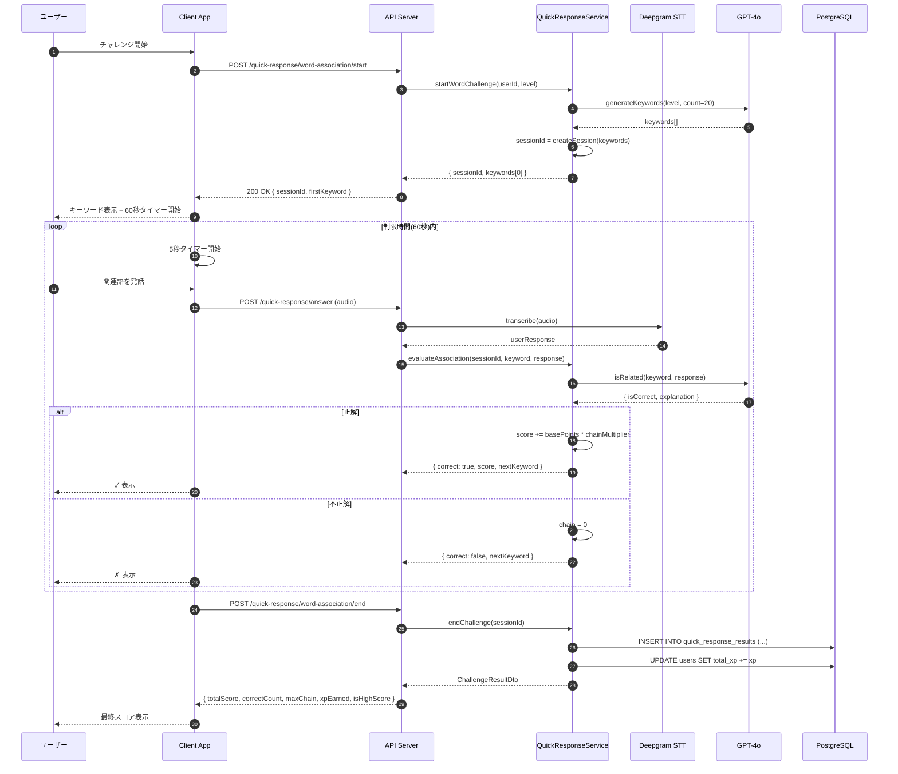
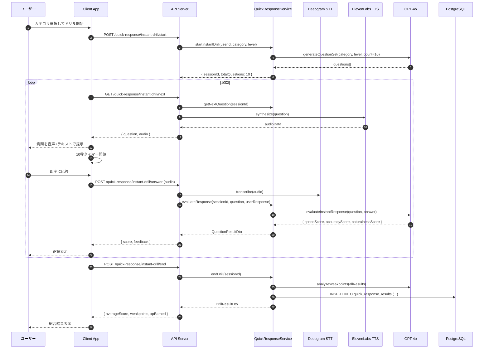
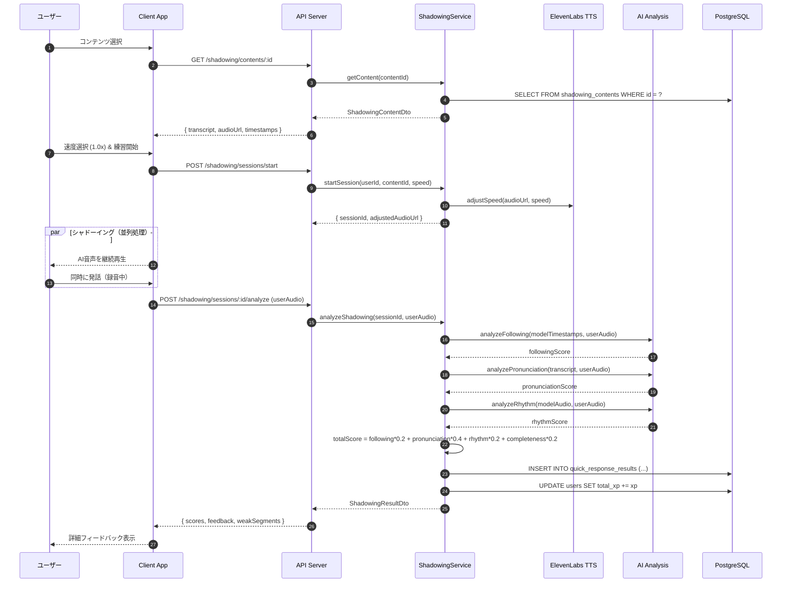

# 6.13. Translation Practice Use Cases (UC-036 ～ UC-038)

> このファイルは翻訳練習機能（続き）に関するコンポーネント設計を定義します。

---

## UC-036: ワード連想チャレンジ

### 処理概要

AI が提示するキーワードから素早く関連語句を発話するチャレンジ。60 秒間で正解数を競う。

### シーケンス図



### Pseudocode

```typescript
async function startWordAssociationChallenge(
  userId: string,
  level: UserLevel
): Promise<ChallengeSession> {
  // 1. 日次制限チェック
  const dailyCount = await getDailyChallengeCount(userId, "word_assoc");
  if (dailyCount >= 3 && (await getUserPlan(userId)) === "free") {
    throw new BusinessException(
      "QR_LIMIT_001",
      "Daily free challenge limit reached"
    );
  }

  // 2. キーワード生成
  const keywords = await llmService.generateKeywords({ level, count: 20 });

  // 3. セッション作成
  const session = {
    id: generateUUID(),
    userId,
    type: "word_assoc",
    keywords,
    currentIndex: 0,
    score: 0,
    correctCount: 0,
    chain: 0,
    maxChain: 0,
    usedResponses: new Set(),
    startedAt: new Date(),
  };
  await cache.set(
    `challenge:${session.id}`,
    JSON.stringify(session),
    "EX",
    120
  );
  return {
    sessionId: session.id,
    firstKeyword: keywords[0],
    totalTime: 60,
    perQuestionTime: 5,
  };
}

async function evaluateAssociation(
  sessionId: string,
  userResponse: string
): Promise<AssociationResult> {
  const session = JSON.parse(await cache.get(`challenge:${sessionId}`));
  if (!session) throw new NotFoundException("QR_003", "Session not found");

  const currentKeyword = session.keywords[session.currentIndex];

  // 重複チェック
  if (session.usedResponses.has(userResponse.toLowerCase())) {
    return {
      correct: false,
      reason: "duplicate",
      score: session.score,
      chain: 0,
    };
  }

  // AI 判定
  const isRelated = await llmService.evaluateAssociation({
    keyword: currentKeyword,
    response: userResponse,
  });

  if (isRelated) {
    session.chain++;
    session.maxChain = Math.max(session.maxChain, session.chain);
    session.correctCount++;
    session.usedResponses.add(userResponse.toLowerCase());

    let multiplier = session.chain >= 10 ? 2.0 : session.chain >= 5 ? 1.5 : 1.0;
    session.score += Math.round(100 * multiplier);
  } else {
    session.chain = 0;
  }

  session.currentIndex++;
  await cache.set(`challenge:${sessionId}`, JSON.stringify(session), "EX", 120);

  return {
    correct: isRelated,
    score: session.score,
    chain: session.chain,
    nextKeyword: session.keywords[session.currentIndex] || null,
  };
}
```

### ビジネスルール

| Rule ID | ルール内容                                           |
| ------- | ---------------------------------------------------- |
| BR-107  | 1 問あたり 5 秒、全体で 60 秒                        |
| BR-108  | チェーンボーナス: 連続 5 問で 1.5 倍、10 問で 2 倍   |
| BR-109  | セッション内で同一の回答は不可                       |
| BR-111  | XP: 10 問正解 50XP、20 問 120XP、ハイスコア更新+30XP |
| BR-112  | 1 日 3 回まで無料                                    |

---

## UC-037: 瞬間応答ドリル

### 処理概要

質問が次々と提示され、学習者が即座に英語で応答するドリル。10 問連続で実施。

### シーケンス図



### Pseudocode

```typescript
async function startInstantDrill(
  userId: string,
  category: string,
  level: UserLevel
): Promise<DrillSession> {
  const dailyCount = await getDailyDrillCount(userId);
  const limit = DAILY_LIMITS[await getUserPlan(userId)].instantDrill;
  if (dailyCount >= limit)
    throw new BusinessException("QR_LIMIT_002", "Daily drill limit reached");

  const questions = await llmService.generateInstantQuestions({
    category,
    level,
    count: 10,
  });
  const session = {
    id: generateUUID(),
    userId,
    type: "instant_drill",
    category,
    questions,
    currentIndex: 0,
    results: [],
    startedAt: new Date(),
  };
  await cache.set(`drill:${session.id}`, JSON.stringify(session), "EX", 600);
  return { sessionId: session.id, totalQuestions: 10, perQuestionTime: 10 };
}

async function evaluateInstantResponse(
  sessionId: string,
  userResponse: string,
  responseTimeSec: number
): Promise<QuestionResult> {
  const session = JSON.parse(await cache.get(`drill:${sessionId}`));
  const question = session.questions[session.currentIndex];

  const aiEval = await llmService.evaluateInstantResponse({
    question,
    answer: userResponse,
    responseTime: responseTimeSec,
  });
  const speedScore = Math.max(0, 100 - responseTimeSec * 10);
  const totalScore = Math.round(
    speedScore * 0.3 +
      aiEval.accuracyScore * 0.4 +
      aiEval.naturalnessScore * 0.3
  );

  session.results.push({
    questionIndex: session.currentIndex,
    totalScore,
    feedback: aiEval.feedback,
  });
  session.currentIndex++;
  await cache.set(`drill:${sessionId}`, JSON.stringify(session), "EX", 600);

  return { totalScore, feedback: aiEval.feedback };
}
```

### ビジネスルール

| Rule ID | ルール内容                                        |
| ------- | ------------------------------------------------- |
| BR-113  | 1 問あたり 10 秒                                  |
| BR-114  | 1 セッション 10 問固定                            |
| BR-115  | 評価基準: 速度 30%、正確性 40%、自然さ 30%        |
| BR-116  | XP: 完了 40XP、平均 80 点以上で追加 25XP          |
| BR-117  | 日次制限: Free 2 回/日、Pro 10 回/日、Plus 無制限 |
| BR-118  | 弱点分析: 3 回以上実施で弱点カテゴリを特定        |

---

## UC-038: シャドーイング練習

### 処理概要

AI が発話する英語を聞きながら同時に発話するシャドーイング練習。追従・発音・リズムを分析。

### シーケンス図



### Pseudocode

```typescript
async function analyzeShadowing(
  sessionId: string,
  userAudioBuffer: Buffer
): Promise<ShadowingResult> {
  const session = JSON.parse(await cache.get(`shadowing:${sessionId}`));
  if (!session) throw new NotFoundException("SHADOW_001", "Session not found");

  const content = await shadowingContentRepository.findById(session.contentId);
  const userTranscript = await sttService.transcribeWithTimestamps(
    userAudioBuffer
  );

  // 分析
  const followingScore = await analyzeFollowingTiming(
    content.timestamps,
    userTranscript.timestamps
  );
  const pronunciationScore = await aiService.analyzePronunciation({
    expectedText: content.transcript,
    audio: userAudioBuffer,
  });
  const rhythmScore = await aiService.analyzeRhythm({
    modelAudioUrl: content.audioUrl,
    userAudio: userAudioBuffer,
  });
  const completenessScore = calculateCompleteness(
    content.transcript,
    userTranscript.text
  );

  const totalScore = Math.round(
    followingScore * 0.2 +
      pronunciationScore * 0.4 +
      rhythmScore * 0.2 +
      completenessScore * 0.2
  );
  const weakSegments = identifyWeakSegments(content.timestamps, userTranscript);

  // XP計算
  let xpEarned = 35;
  if (totalScore >= 90) xpEarned += 20;

  await quickResponseResultRepository.create({
    userId: session.userId,
    practiceType: "shadowing",
    contentId: session.contentId,
    totalScore,
    followingScore,
    pronunciationScore,
    rhythmScore,
    durationSec: content.durationSec,
    details: { weakSegments, completenessScore },
    xpEarned,
  });

  await userService.addXP(session.userId, xpEarned);
  await cache.del(`shadowing:${sessionId}`);

  return {
    totalScore,
    followingScore,
    pronunciationScore,
    rhythmScore,
    completenessScore,
    weakSegments,
    xpEarned,
  };
}

function analyzeFollowingTiming(
  modelTs: SentenceTimestamp[],
  userTs: SentenceTimestamp[]
): number {
  let totalScore = 0,
    matched = 0;
  for (const m of modelTs) {
    const u = userTs.find((x) => levenshteinSimilarity(x.text, m.text) > 0.8);
    if (u) {
      matched++;
      const delay = u.startTime - m.startTime;
      if (delay >= 0 && delay <= 1.0) totalScore += 100;
      else if (delay > 0 && delay <= 2.0) totalScore += 70;
      else totalScore += 40;
    }
  }
  return matched > 0 ? Math.round(totalScore / matched) : 0;
}
```

### ビジネスルール

| Rule ID | ルール内容                                        |
| ------- | ------------------------------------------------- |
| BR-119  | 速度調整: 0.75x / 1.0x / 1.25x の 3 段階          |
| BR-120  | コンテンツ長: 30 秒〜3 分                         |
| BR-121  | 評価: 追従 20%、発音 40%、リズム 20%、完成度 20%  |
| BR-122  | XP: 完了 35XP、90 点以上で追加 20XP               |
| BR-123  | 日次制限: Free 5 回/日、Pro 20 回/日、Plus 無制限 |
| BR-124  | Free: 基本コンテンツのみ、有料: 全コンテンツ      |

---

## エラーハンドリング

| エラーコード | HTTP | エラー種別      | メッセージ                         |
| ------------ | ---- | --------------- | ---------------------------------- |
| TRANS_001    | 403  | マイク権限なし  | マイクへのアクセスを許可して下さい |
| TRANS_002    | 503  | AI サービス障害 | 採点サービスが一時的に利用不可     |
| TRANS_003    | 400  | 音声認識失敗    | 音声を認識できませんでした         |
| TRANS_004    | 404  | 問題なし        | 利用可能な問題がありません         |
| TRANS_LIMIT  | 429  | 日次制限        | 本日の練習回数上限に達しました     |
| QR_003       | 404  | セッションなし  | セッションが見つかりません         |
| SHADOW_001   | 404  | セッションなし  | セッションが見つかりません         |

---

## UC カバレッジサマリー

| UC ID  | UC 名          | シーケンス図 | Pseudocode | ビジネスルール | ステータス |
| ------ | -------------- | ------------ | ---------- | -------------- | ---------- |
| UC-034 | ダイレクト翻訳 | ✅           | ✅         | ✅             | ✅ 完了    |
| UC-035 | 高度意図翻訳   | ✅           | ✅         | ✅             | ✅ 完了    |
| UC-036 | ワード連想     | ✅           | ✅         | ✅             | ✅ 完了    |
| UC-037 | 瞬間応答ドリル | ✅           | ✅         | ✅             | ✅ 完了    |
| UC-038 | シャドーイング | ✅           | ✅         | ✅             | ✅ 完了    |

---

← [前: translation-01.md](./translation-01.md) | [目次](../06-component-design.md)
