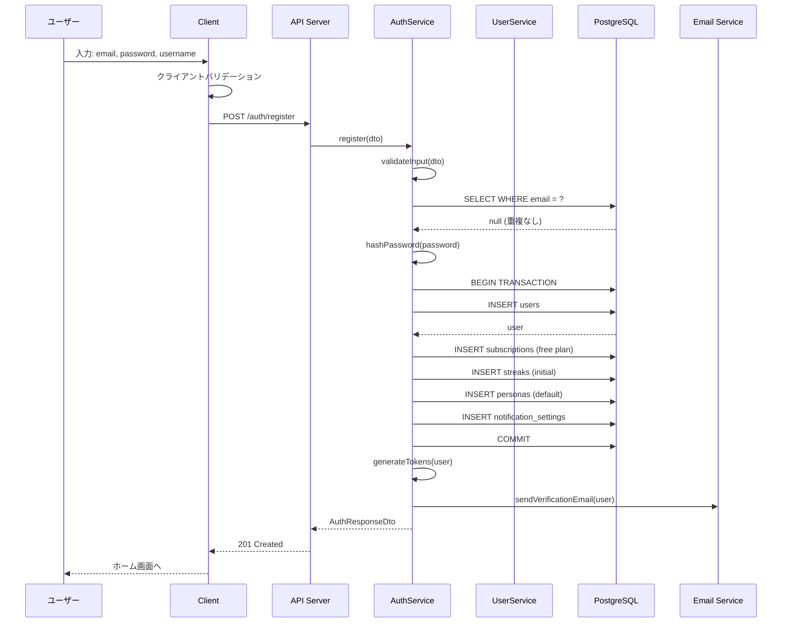
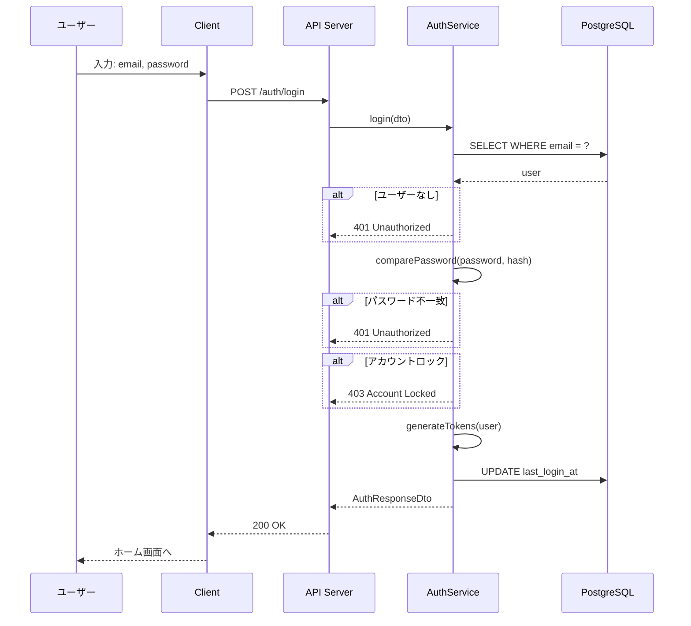

# 6.5. User Use Cases (UC-011 ～ UC-013)

## UC-011: ユーザー登録

### 処理概要

新規ユーザーアカウントを作成し、初期データをセットアップする。

### シーケンス図



### Pseudocode

```typescript
async function register(dto: RegisterDto): Promise<AuthResponseDto> {
  // 1. バリデーション
  await validateInput(dto);

  // 2. メール重複チェック
  const existing = await userRepository.findByEmail(dto.email);
  if (existing) {
    throw new ConflictException("Email already exists");
  }

  // 3. パスワードハッシュ化
  const passwordHash = await hashUtil.hashPassword(dto.password);

  // 4. トランザクションで初期データ作成
  const result = await prisma.$transaction(async (tx) => {
    // 4.1 ユーザー作成
    const user = await tx.user.create({
      data: {
        email: dto.email,
        username: dto.username,
        passwordHash,
        level: "Beginner",
        totalXp: 0,
        league: "Bronze",
      },
    });

    // 4.2 サブスクリプション (Free)
    await tx.subscription.create({
      data: {
        userId: user.id,
        plan: "free",
        dailyUsageLimit: 3,
      },
    });

    // 4.3 ストリーク初期化
    await tx.streak.create({
      data: {
        userId: user.id,
        currentStreak: 0,
        longestStreak: 0,
        freezeRemaining: 0,
      },
    });

    // 4.4 デフォルトペルソナ
    await tx.persona.create({
      data: {
        userId: user.id,
        name: "Default",
        voice: "voice_1",
        personality: "cheerful",
        targetLevel: "Beginner",
        isDefault: true,
      },
    });

    // 4.5 通知設定
    await tx.notificationSetting.create({
      data: {
        userId: user.id,
        pushEnabled: true,
        emailEnabled: true,
        streakReminder: true,
      },
    });

    return user;
  });

  // 5. JWT 生成
  const tokens = generateTokens(result);

  // 6. 確認メール送信 (非同期)
  emailQueue.add("VERIFICATION", { userId: result.id, email: result.email });

  // 7. バッジチェック
  await badgeService.checkAndAward(result.id, "FIRST_REGISTRATION");

  return {
    accessToken: tokens.accessToken,
    refreshToken: tokens.refreshToken,
    expiresIn: 3600,
    user: UserResponseDto.fromEntity(result),
  };
}
```

### バリデーションルール

| フィールド | 条件             | エラーメッセージ        |
| ---------- | ---------------- | ----------------------- |
| email      | 有効なメール形式 | Invalid email format    |
| email      | 最大 255 文字    | Email too long          |
| email      | 未使用           | Email already exists    |
| password   | 8-128 文字       | Password length invalid |
| password   | 英字+数字を含む  | Password too weak       |
| username   | 3-50 文字        | Username length invalid |
| username   | 英数字と\_-のみ  | Invalid characters      |

---

## UC-012: ログイン/認証

### シーケンス図



### ビジネスルール

| Rule ID | ルール内容                                   |
| ------- | -------------------------------------------- |
| BR-011  | 5 回連続でログイン失敗すると 30 分ロック     |
| BR-012  | ロック中はパスワードリセットのみ可能         |
| BR-013  | メール未確認でもログイン可能（一部機能制限） |

---

← [Feedback UCs](./feedback-01.md) | _次: [Subscription UCs](./subscription-01.md)_
