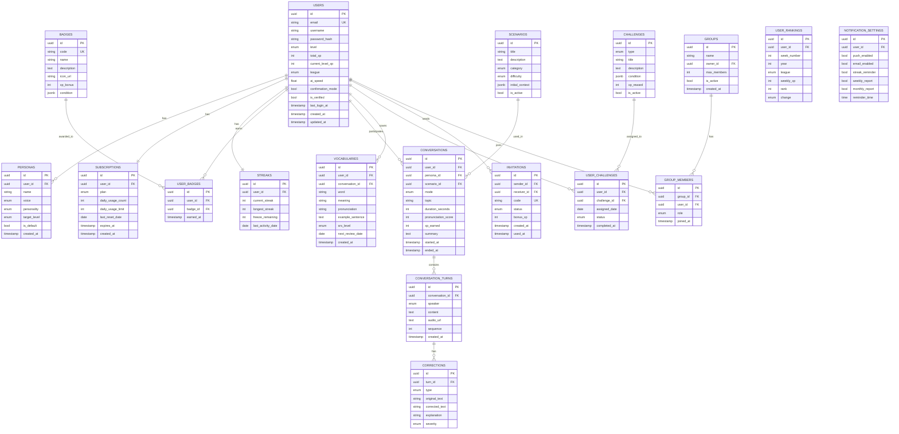

# 7. データベース設計

> 📋 このドキュメントはデータベース設計の概要と各セクションへのリンクを提供します。

---

## 7.1. 概要

### 統計情報

| 項目                     | 数量 |
| ------------------------ | ---- |
| テーブル総数             | 18   |
| マスタテーブル           | 5    |
| トランザクションテーブル | 13   |

### データベース構成

| 項目         | 設定            |
| ------------ | --------------- |
| RDBMS        | PostgreSQL 15.x |
| 文字コード   | UTF-8           |
| 照合順序     | en_US.UTF-8     |
| タイムゾーン | UTC             |

---

## 7.2. 目次

| セクション | ファイル                                                            | 内容                    |
| ---------- | ------------------------------------------------------------------- | ----------------------- |
| 7.3        | [ER 図](./07-database-design/01-er-diagram.md)                      | エンティティ関係図      |
| 7.4        | [ユーザー系](./07-database-design/user-tables.md)                   | users, personas 等      |
| 7.5        | [会話系](./07-database-design/conversation-tables.md)               | conversations, turns 等 |
| 7.6        | [学習系](./07-database-design/learning-tables.md)                   | vocabularies 等         |
| 7.7        | [ゲーミフィケーション](./07-database-design/gamification-tables.md) | streaks, badges 等      |
| 7.8        | [ソーシャル系](./07-database-design/social-tables.md)               | invitations, groups 等  |

---

## 7.3. ER 図



---

## 7.4. 共通カラム規約

### 型規約

| 論理型     | PostgreSQL 型            | 説明             |
| ---------- | ------------------------ | ---------------- |
| ID         | UUID                     | PRIMARY KEY      |
| 外部キー   | UUID                     | REFERENCES       |
| 文字列(短) | VARCHAR(n)               | 長さ制限あり     |
| 文字列(長) | TEXT                     | 長さ制限なし     |
| 列挙型     | VARCHAR(50)              | アプリ層で制約   |
| 数値       | INTEGER                  | 32 ビット整数    |
| 小数       | NUMERIC(10,2)            | 金額等           |
| 真偽値     | BOOLEAN                  | true/false       |
| 日付       | DATE                     | 日付のみ         |
| 日時       | TIMESTAMP WITH TIME ZONE | タイムゾーン付き |
| JSON       | JSONB                    | バイナリ JSON    |

### 共通カラム

| カラム名   | 型                       | 必須 | 説明             |
| ---------- | ------------------------ | ---- | ---------------- |
| id         | UUID                     | ○    | 主キー           |
| created_at | TIMESTAMP WITH TIME ZONE | ○    | 作成日時（自動） |
| updated_at | TIMESTAMP WITH TIME ZONE | -    | 更新日時（自動） |

---

## 7.5. インデックス戦略

### インデックス種別

| 種別        | 用途               | 対象例                |
| ----------- | ------------------ | --------------------- |
| PRIMARY KEY | 主キー             | id                    |
| UNIQUE      | 一意制約           | email, code           |
| B-tree      | 範囲検索、等価検索 | user_id, created_at   |
| GIN         | JSONB 検索         | condition             |
| 複合        | 複数カラム検索     | (user_id, created_at) |

### 主要インデックス一覧

| テーブル        | インデックス名                 | カラム                    |
| --------------- | ------------------------------ | ------------------------- |
| users           | idx_users_email                | email                     |
| conversations   | idx_conversations_user_started | user_id, started_at DESC  |
| vocabularies    | idx_vocabularies_user_review   | user_id, next_review_date |
| user_challenges | idx_user_challenges_user_date  | user_id, assigned_date    |
| user_rankings   | idx_user_rankings_week_league  | week_number, year, league |

---

## 7.6. パーティショニング

### 対象テーブル

| テーブル           | パーティション方式 | キー       | 保持期間 |
| ------------------ | ------------------ | ---------- | -------- |
| conversations      | RANGE (月次)       | started_at | 12 ヶ月  |
| conversation_turns | RANGE (月次)       | created_at | 6 ヶ月   |
| user_rankings      | RANGE (年次)       | year       | 3 年     |

### パーティション DDL 例

```sql
-- 月次パーティション
CREATE TABLE conversations (
    id UUID NOT NULL,
    user_id UUID NOT NULL,
    started_at TIMESTAMP WITH TIME ZONE NOT NULL,
    ...
) PARTITION BY RANGE (started_at);

-- 2025年1月パーティション
CREATE TABLE conversations_2025_01
    PARTITION OF conversations
    FOR VALUES FROM ('2025-01-01') TO ('2025-02-01');
```

---

## 7.7. マイグレーション戦略

### ツール

| ツール | 用途                           |
| ------ | ------------------------------ |
| Prisma | スキーマ管理、マイグレーション |

### 命名規則

```
YYYYMMDDHHMMSS_description.sql
例: 20251229120000_create_users_table.sql
```

### ロールバック

```bash
# マイグレーション実行
npx prisma migrate deploy

# ロールバック（手動）
npx prisma migrate resolve --rolled-back MIGRATION_NAME
```

---

← [目次](./_index.md) | _次のセクション: [08-api-design.md](./08-api-design.md)_
