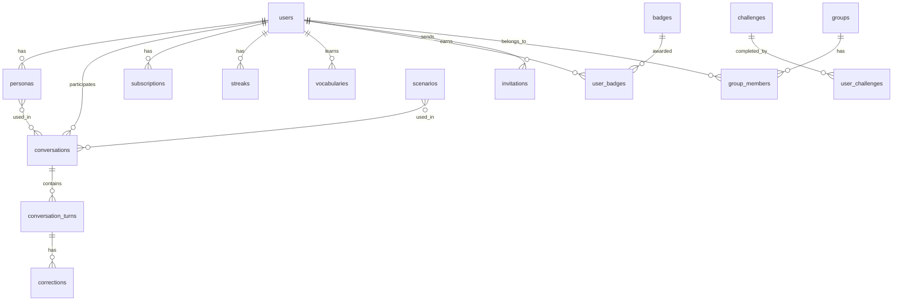

# 7. データベース設計 - 共通仕様

> 📌 **ENHANCED**: Transaction patterns, index strategy, performance notes

---

## 7.1. 概要

### 7.1.1. データベース構成

| 項目         | 仕様                       |
| ------------ | -------------------------- |
| RDBMS        | PostgreSQL 15              |
| Engine       | InnoDB equivalent (MVCC)   |
| Charset      | UTF-8 (utf8mb4 equivalent) |
| Timezone     | UTC (アプリ側で JST 変換)  |
| 総テーブル数 | 18                         |

### 7.1.2. テーブルカテゴリ

| カテゴリ          | テーブル数 | 説明                         |
| ----------------- | ---------- | ---------------------------- |
| User 関連         | 5          | users, personas, sessions 等 |
| Conversation 関連 | 4          | conversations, turns 等      |
| Learning 関連     | 4          | scenarios, vocabularies 等   |
| Gamification 関連 | 3          | streaks, badges, rankings    |
| Social 関連       | 2          | invitations, groups          |

---

## 7.2. ファイル構成

| セクション | ファイル                                                           | 内容                     |
| ---------- | ------------------------------------------------------------------ | ------------------------ |
| 7.3        | [User Tables](./07-database-design/user-tables.md)                 | ユーザー系テーブル DDL   |
| 7.4        | [Conversation Tables](./07-database-design/conversation-tables.md) | 会話系テーブル DDL       |
| 7.5        | [Learning Tables](./07-database-design/learning-tables.md)         | 学習系テーブル DDL       |
| 7.6        | [Gamification Tables](./07-database-design/gamification-tables.md) | ゲーミフィケーション DDL |
| 7.7        | [Social Tables](./07-database-design/social-tables.md)             | ソーシャル系テーブル DDL |

---

## 7.3. Transaction Isolation Levels

> 📌 **ENHANCED** (ENH-04): 各操作タイプ別のトランザクション分離レベル

### 7.3.1. 分離レベル定義

| 操作カテゴリ           | Isolation Level | 理由                       |
| ---------------------- | --------------- | -------------------------- |
| ユーザー登録           | READ COMMITTED  | 標準的な CRUD              |
| ログイン認証           | READ COMMITTED  | パフォーマンス優先         |
| 会話セッション作成     | READ COMMITTED  | 低競合                     |
| 会話ターン追加         | READ COMMITTED  | 順序保証はシーケンス番号で |
| XP/レベル更新          | REPEATABLE READ | 二重付与防止               |
| ストリーク更新         | REPEATABLE READ | 日次更新の競合防止         |
| サブスクリプション変更 | SERIALIZABLE    | 決済整合性必須             |
| バッチ処理（日次統計） | READ COMMITTED  | スナップショット許容       |
| ランキング更新         | REPEATABLE READ | 週次集計の一貫性           |

### 7.3.2. PostgreSQL 設定例

```sql
-- セッション開始時に設定
SET TRANSACTION ISOLATION LEVEL READ COMMITTED;  -- デフォルト
SET TRANSACTION ISOLATION LEVEL REPEATABLE READ; -- XP/Streak操作
SET TRANSACTION ISOLATION LEVEL SERIALIZABLE;    -- 課金操作

-- または NestJS/Prisma で
@Transaction({
  isolationLevel: Prisma.TransactionIsolationLevel.RepeatableRead
})
async updateUserXP(userId: string, xp: number): Promise<void> {
  // ...
}
```

### 7.3.3. Deadlock Prevention Strategy

```
DEADLOCK PREVENTION RULES:
1. リソースアクセス順序を統一
   - users → subscriptions → conversations → turns の順
2. ロック取得にタイムアウト設定 (5秒)
3. 楽観的ロック (version column) を優先使用
4. 悲観的ロック (SELECT FOR UPDATE) は最小限に

VERSION COLUMN PATTERN:
  IF updated_rows == 0:
    THROW OptimisticLockException
    RETRY (max 3 times with exponential backoff)
```

---

## 7.4. Index Strategy

> 📌 **ENHANCED** (ENH-05): インデックス設計と最適化戦略

### 7.4.1. インデックスタイプ

| タイプ | 用途               | PostgreSQL 構文           |
| ------ | ------------------ | ------------------------- |
| B-Tree | 等価・範囲検索     | CREATE INDEX (デフォルト) |
| Hash   | 完全一致検索       | USING HASH                |
| GIN    | 配列・全文検索     | USING GIN                 |
| BRIN   | 大量データ範囲検索 | USING BRIN                |

### 7.4.2. 主要テーブル別インデックス戦略

#### users テーブル

```sql
-- Primary Key (自動)
-- B-Tree: PK lookup

-- Email での検索（ログイン）
CREATE UNIQUE INDEX idx_users_email ON users(email);
-- 使用頻度: 高, カーディナリティ: 高

-- OAuth プロバイダー検索
CREATE INDEX idx_users_oauth ON users(oauth_provider, oauth_id)
  WHERE oauth_provider IS NOT NULL;
-- 条件付きインデックス

-- レベル別検索（マッチング）
CREATE INDEX idx_users_level ON users(level);
-- カーディナリティ: 低, クエリ頻度: 中
```

#### conversations テーブル

```sql
-- ユーザーの会話一覧取得
CREATE INDEX idx_conversations_user_started
  ON conversations(user_id, started_at DESC);
-- 複合インデックス、降順

-- 日次利用量チェック
CREATE INDEX idx_conversations_user_date
  ON conversations(user_id, DATE(started_at));
-- 日付関数インデックス

-- アクティブセッション検索
CREATE INDEX idx_conversations_active
  ON conversations(user_id)
  WHERE ended_at IS NULL;
-- 部分インデックス
```

#### conversation_turns テーブル

```sql
-- 会話のターン一覧取得
CREATE INDEX idx_turns_conversation_seq
  ON conversation_turns(conversation_id, sequence);
-- 複合インデックス

-- ユーザー発話のみ抽出
CREATE INDEX idx_turns_user_speaker
  ON conversation_turns(conversation_id)
  WHERE speaker = 'user';
-- 部分インデックス
```

#### vocabularies テーブル

```sql
-- 復習対象取得（SRS）
CREATE INDEX idx_vocabularies_due
  ON vocabularies(user_id, next_review_at, srs_level)
  WHERE next_review_at IS NOT NULL;
-- 複合インデックス + 部分条件

-- 単語検索
CREATE INDEX idx_vocabularies_word
  ON vocabularies USING GIN(word gin_trgm_ops);
-- Trigram インデックス（部分一致検索用）
```

### 7.4.3. インデックス性能ガイドライン

| メトリクス               | 基準値   | アクション         |
| ------------------------ | -------- | ------------------ |
| Index Scan Percentage    | > 80%    | ✅ 良好            |
| Seq Scan (大テーブル)    | < 20%    | インデックス見直し |
| Index Bloat              | < 30%    | REINDEX or VACUUM  |
| Unused Index (30 日以上) | 削除検討 | DROP INDEX         |

---

## 7.5. 予測データ量と推奨パーティショニング

### 7.5.1. 予測行数

| テーブル           | 1 年後     | 3 年後 | パーティション推奨 |
| ------------------ | ---------- | ------ | ------------------ |
| users              | 100K       | 500K   | ❌ 不要            |
| conversations      | 5M         | 30M    | ✅ 月次            |
| conversation_turns | 50M        | 300M   | ✅ 月次            |
| vocabularies       | 2M         | 10M    | ❌ 不要            |
| streaks            | 100K       | 500K   | ❌ 不要            |
| user_statistics    | 36M (日次) | 108M   | ✅ 月次            |

### 7.5.2. パーティショニング例

```sql
-- conversationsテーブル: 月次パーティション
CREATE TABLE conversations (
    id UUID PRIMARY KEY,
    user_id UUID NOT NULL,
    started_at TIMESTAMPTZ NOT NULL,
    -- other columns...
) PARTITION BY RANGE (started_at);

-- 月別パーティション作成
CREATE TABLE conversations_2025_01 PARTITION OF conversations
    FOR VALUES FROM ('2025-01-01') TO ('2025-02-01');
CREATE TABLE conversations_2025_02 PARTITION OF conversations
    FOR VALUES FROM ('2025-02-01') TO ('2025-03-01');
-- ...以下同様

-- 自動パーティション管理（pg_partman使用推奨）
```

---

## 7.6. ER Diagram (Summary)



---

## 7.7. BD 参照マトリクス

| DD Section       | BD Section                | Coverage |
| ---------------- | ------------------------- | -------- |
| 7.3 User Tables  | BD 05-data-design (1-5)   | ✅ 100%  |
| 7.4 Conversation | BD 05-data-design (6-9)   | ✅ 100%  |
| 7.5 Learning     | BD 05-data-design (10-13) | ✅ 100%  |
| 7.6 Gamification | BD 05-data-design (14-16) | ✅ 100%  |
| 7.7 Social       | BD 05-data-design (17-18) | ✅ 100%  |

> 📋 BD Reference: [基本設計書/05-data-design.md](../基本設計書/05-data-design.md)

---

_メインファイル: [../07-database-design.md](../07-database-design.md)_
