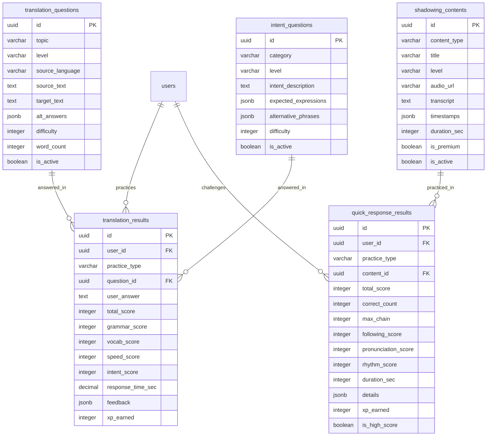

# 7.6. Translation Tables (TBL-019 ～ TBL-023)

> このファイルは翻訳練習機能に関するデータベース設計を定義します。

---

## テーブルサマリー

| No  | テーブル名             | 論理名                   | 種別             | 関連 FR        |
| --- | ---------------------- | ------------------------ | ---------------- | -------------- |
| 19  | translation_questions  | 翻訳問題                 | マスタ           | FR-034         |
| 20  | translation_results    | 翻訳練習結果             | トランザクション | FR-034, FR-035 |
| 21  | intent_questions       | 意図問題                 | マスタ           | FR-035         |
| 22  | shadowing_contents     | シャドーイングコンテンツ | マスタ           | FR-038         |
| 23  | quick_response_results | クイック応答結果         | トランザクション | FR-036〜038    |

---

## TBL-019: translation_questions

### テーブル情報

| 項目     | 内容           |
| -------- | -------------- |
| 論理名   | 翻訳問題       |
| 種別     | マスタ         |
| 関連 FR  | FR-034         |
| 予定行数 | 5,000 - 10,000 |

### DDL

```sql
CREATE TABLE translation_questions (
    id UUID PRIMARY KEY DEFAULT gen_random_uuid(),
    topic VARCHAR(50) NOT NULL,
    level VARCHAR(20) NOT NULL,
    source_language VARCHAR(10) NOT NULL DEFAULT 'ja',
    source_text TEXT NOT NULL,
    target_text TEXT NOT NULL,
    alt_answers JSONB DEFAULT '[]'::jsonb,
    difficulty INTEGER NOT NULL DEFAULT 1 CHECK (difficulty BETWEEN 1 AND 5),
    word_count INTEGER NOT NULL,
    grammar_points JSONB DEFAULT '[]'::jsonb,
    is_active BOOLEAN NOT NULL DEFAULT true,
    created_at TIMESTAMP NOT NULL DEFAULT CURRENT_TIMESTAMP,
    updated_at TIMESTAMP NOT NULL DEFAULT CURRENT_TIMESTAMP
);

-- コメント
COMMENT ON TABLE translation_questions IS 'ダイレクト翻訳練習用の問題データ';
COMMENT ON COLUMN translation_questions.topic IS '日常会話/ビジネス/旅行等';
COMMENT ON COLUMN translation_questions.level IS 'Beginner/Intermediate/Upper/Advanced';
COMMENT ON COLUMN translation_questions.source_language IS 'ja/vi/ko等';
COMMENT ON COLUMN translation_questions.alt_answers IS '許容される代替解答リスト';
COMMENT ON COLUMN translation_questions.grammar_points IS '含まれる文法項目';

-- インデックス
CREATE INDEX idx_trans_q_topic_level ON translation_questions(topic, level);
CREATE INDEX idx_trans_q_level_difficulty ON translation_questions(level, difficulty);
CREATE INDEX idx_trans_q_source_lang ON translation_questions(source_language);
CREATE INDEX idx_trans_q_active ON translation_questions(is_active) WHERE is_active = true;

-- 更新日時トリガー
CREATE TRIGGER update_translation_questions_updated_at
    BEFORE UPDATE ON translation_questions
    FOR EACH ROW EXECUTE FUNCTION update_updated_at_column();
```

---

## TBL-020: translation_results

### テーブル情報

| 項目     | 内容                |
| -------- | ------------------- |
| 論理名   | 翻訳練習結果        |
| 種別     | トランザクション    |
| 関連 FR  | FR-034, FR-035      |
| 予定行数 | 100,000 - 1,000,000 |

### DDL

```sql
CREATE TABLE translation_results (
    id UUID PRIMARY KEY DEFAULT gen_random_uuid(),
    user_id UUID NOT NULL REFERENCES users(id) ON DELETE CASCADE,
    practice_type VARCHAR(20) NOT NULL CHECK (practice_type IN ('direct', 'intent')),
    question_id UUID REFERENCES translation_questions(id),
    user_answer TEXT NOT NULL,
    total_score INTEGER NOT NULL CHECK (total_score BETWEEN 0 AND 100),
    grammar_score INTEGER NOT NULL CHECK (grammar_score BETWEEN 0 AND 100),
    vocab_score INTEGER NOT NULL CHECK (vocab_score BETWEEN 0 AND 100),
    speed_score INTEGER CHECK (speed_score BETWEEN 0 AND 100),
    intent_score INTEGER CHECK (intent_score BETWEEN 0 AND 100),
    response_time_sec DECIMAL(5,2) NOT NULL,
    feedback JSONB,
    xp_earned INTEGER NOT NULL DEFAULT 0,
    created_at TIMESTAMP NOT NULL DEFAULT CURRENT_TIMESTAMP
);

-- コメント
COMMENT ON TABLE translation_results IS '翻訳練習の結果履歴';
COMMENT ON COLUMN translation_results.practice_type IS 'direct: ダイレクト翻訳, intent: 意図翻訳';
COMMENT ON COLUMN translation_results.speed_score IS 'directタイプのみ使用';
COMMENT ON COLUMN translation_results.intent_score IS 'intentタイプのみ使用';

-- インデックス
CREATE INDEX idx_trans_result_user ON translation_results(user_id);
CREATE INDEX idx_trans_result_user_date ON translation_results(user_id, created_at DESC);
CREATE INDEX idx_trans_result_question ON translation_results(question_id);
CREATE INDEX idx_trans_result_user_type_date ON translation_results(user_id, practice_type, created_at DESC);

-- パーティション（Option: 月次）
-- CREATE TABLE translation_results_2026_01 PARTITION OF translation_results
--     FOR VALUES FROM ('2026-01-01') TO ('2026-02-01');
```

---

## TBL-021: intent_questions

### テーブル情報

| 項目     | 内容          |
| -------- | ------------- |
| 論理名   | 意図問題      |
| 種別     | マスタ        |
| 関連 FR  | FR-035        |
| 予定行数 | 1,000 - 3,000 |

### DDL

```sql
CREATE TABLE intent_questions (
    id UUID PRIMARY KEY DEFAULT gen_random_uuid(),
    category VARCHAR(50) NOT NULL,
    level VARCHAR(20) NOT NULL,
    intent_description TEXT NOT NULL,
    expected_expressions JSONB NOT NULL,
    alternative_phrases JSONB NOT NULL,
    difficulty INTEGER NOT NULL DEFAULT 1 CHECK (difficulty BETWEEN 1 AND 5),
    is_active BOOLEAN NOT NULL DEFAULT true,
    created_at TIMESTAMP NOT NULL DEFAULT CURRENT_TIMESTAMP,
    updated_at TIMESTAMP NOT NULL DEFAULT CURRENT_TIMESTAMP
);

-- コメント
COMMENT ON TABLE intent_questions IS '高度意図翻訳用の意図・シチュエーション';
COMMENT ON COLUMN intent_questions.category IS '挨拶/日常/ビジネス等';
COMMENT ON COLUMN intent_questions.intent_description IS 'シチュエーションの説明';
COMMENT ON COLUMN intent_questions.expected_expressions IS '正解とみなせる表現パターン';
COMMENT ON COLUMN intent_questions.alternative_phrases IS '表示用の代替表現リスト';

-- インデックス
CREATE INDEX idx_intent_q_category_level ON intent_questions(category, level);
CREATE INDEX idx_intent_q_difficulty ON intent_questions(difficulty);
CREATE INDEX idx_intent_q_active ON intent_questions(is_active) WHERE is_active = true;

-- 更新日時トリガー
CREATE TRIGGER update_intent_questions_updated_at
    BEFORE UPDATE ON intent_questions
    FOR EACH ROW EXECUTE FUNCTION update_updated_at_column();
```

---

## TBL-022: shadowing_contents

### テーブル情報

| 項目     | 内容                     |
| -------- | ------------------------ |
| 論理名   | シャドーイングコンテンツ |
| 種別     | マスタ                   |
| 関連 FR  | FR-038                   |
| 予定行数 | 500 - 2,000              |

### DDL

```sql
CREATE TABLE shadowing_contents (
    id UUID PRIMARY KEY DEFAULT gen_random_uuid(),
    content_type VARCHAR(30) NOT NULL,
    title VARCHAR(200) NOT NULL,
    description TEXT,
    level VARCHAR(20) NOT NULL,
    audio_url VARCHAR(500) NOT NULL,
    transcript TEXT NOT NULL,
    timestamps JSONB,
    duration_sec INTEGER NOT NULL CHECK (duration_sec BETWEEN 30 AND 180),
    is_premium BOOLEAN NOT NULL DEFAULT false,
    is_active BOOLEAN NOT NULL DEFAULT true,
    created_at TIMESTAMP NOT NULL DEFAULT CURRENT_TIMESTAMP,
    updated_at TIMESTAMP NOT NULL DEFAULT CURRENT_TIMESTAMP
);

-- コメント
COMMENT ON TABLE shadowing_contents IS 'シャドーイング練習用の教材';
COMMENT ON COLUMN shadowing_contents.content_type IS '会話/ニュース/スピーチ等';
COMMENT ON COLUMN shadowing_contents.timestamps IS '文ごとの開始時間 [{start: 0.0, end: 2.5, text: "..."}]';
COMMENT ON COLUMN shadowing_contents.is_premium IS '有料ユーザー限定コンテンツ';

-- インデックス
CREATE INDEX idx_shadow_content_type_level ON shadowing_contents(content_type, level);
CREATE INDEX idx_shadow_premium ON shadowing_contents(is_premium);
CREATE INDEX idx_shadow_active ON shadowing_contents(is_active) WHERE is_active = true;

-- 更新日時トリガー
CREATE TRIGGER update_shadowing_contents_updated_at
    BEFORE UPDATE ON shadowing_contents
    FOR EACH ROW EXECUTE FUNCTION update_updated_at_column();
```

---

## TBL-023: quick_response_results

### テーブル情報

| 項目     | 内容                   |
| -------- | ---------------------- |
| 論理名   | クイック応答結果       |
| 種別     | トランザクション       |
| 関連 FR  | FR-036, FR-037, FR-038 |
| 予定行数 | 50,000 - 500,000       |

### DDL

```sql
CREATE TABLE quick_response_results (
    id UUID PRIMARY KEY DEFAULT gen_random_uuid(),
    user_id UUID NOT NULL REFERENCES users(id) ON DELETE CASCADE,
    practice_type VARCHAR(30) NOT NULL CHECK (practice_type IN ('word_assoc', 'instant_drill', 'shadowing')),
    content_id UUID REFERENCES shadowing_contents(id),
    total_score INTEGER NOT NULL CHECK (total_score >= 0),
    correct_count INTEGER,
    max_chain INTEGER,
    following_score INTEGER CHECK (following_score BETWEEN 0 AND 100),
    pronunciation_score INTEGER CHECK (pronunciation_score BETWEEN 0 AND 100),
    rhythm_score INTEGER CHECK (rhythm_score BETWEEN 0 AND 100),
    duration_sec INTEGER NOT NULL,
    details JSONB,
    xp_earned INTEGER NOT NULL DEFAULT 0,
    is_high_score BOOLEAN NOT NULL DEFAULT false,
    created_at TIMESTAMP NOT NULL DEFAULT CURRENT_TIMESTAMP
);

-- コメント
COMMENT ON TABLE quick_response_results IS 'ワード連想・瞬間応答・シャドーイングの結果';
COMMENT ON COLUMN quick_response_results.practice_type IS 'word_assoc/instant_drill/shadowing';
COMMENT ON COLUMN quick_response_results.content_id IS 'shadowing_contents.id (シャドーイングのみ)';
COMMENT ON COLUMN quick_response_results.correct_count IS 'ワード連想・瞬間応答用';
COMMENT ON COLUMN quick_response_results.max_chain IS 'ワード連想用 最大連続正解数';
COMMENT ON COLUMN quick_response_results.following_score IS 'シャドーイング用 追従スコア';
COMMENT ON COLUMN quick_response_results.details IS '各問題/文ごとの詳細結果';

-- インデックス
CREATE INDEX idx_quick_result_user ON quick_response_results(user_id);
CREATE INDEX idx_quick_result_user_type ON quick_response_results(user_id, practice_type);
CREATE INDEX idx_quick_result_user_date ON quick_response_results(user_id, created_at DESC);
CREATE INDEX idx_quick_result_highscore ON quick_response_results(practice_type, total_score DESC);
CREATE INDEX idx_quick_result_user_type_highscore ON quick_response_results(user_id, practice_type, is_high_score) WHERE is_high_score = true;
```

---

## ER 図



---

## サンプルデータ

```sql
-- translation_questions サンプル
INSERT INTO translation_questions (topic, level, source_language, source_text, target_text, alt_answers, difficulty, word_count) VALUES
('daily', 'Beginner', 'ja', '今日の天気はとても良いですね', 'The weather is very nice today', '["It''s a beautiful day today", "What nice weather we have today"]'::jsonb, 1, 6),
('daily', 'Intermediate', 'ja', '来週の会議に参加できるかどうか確認させてください', 'Let me check if I can attend the meeting next week', '["I''ll confirm whether I can join the meeting next week"]'::jsonb, 3, 11),
('business', 'Upper', 'ja', 'この提案について検討していただけますでしょうか', 'Would you please consider this proposal?', '["Could you take a moment to review this proposal?"]'::jsonb, 4, 6);

-- intent_questions サンプル
INSERT INTO intent_questions (category, level, intent_description, expected_expressions, alternative_phrases, difficulty) VALUES
('business', 'Intermediate', '会議で同僚の提案に反対したいのですが、失礼にならないように丁寧に意見を述べてください', '["I see your point", "I respectfully disagree", "I have a different perspective"]'::jsonb, '["I see your point, however...", "That''s an interesting idea, but...", "I respectfully disagree because..."]'::jsonb, 3),
('daily', 'Intermediate', '友達が落ち込んでいます。励ましの言葉をかけてください', '["cheer up", "things will get better", "I''m here for you", "it''s going to be okay"]'::jsonb, '["Cheer up! Things will get better.", "I''m here for you if you need to talk.", "Everything is going to be okay."]'::jsonb, 2);

-- shadowing_contents サンプル
INSERT INTO shadowing_contents (content_type, title, description, level, audio_url, transcript, timestamps, duration_sec, is_premium) VALUES
('conversation', 'Coffee Shop Order', '日常的なコーヒーショップでの注文', 'Beginner', '/audio/shadowing/coffee-shop.mp3', 'Hello, what can I get for you today? I would like a medium latte, please. Would you like any flavor? Yes, vanilla please.', '[{"start": 0.0, "end": 2.0, "text": "Hello, what can I get for you today?"}, {"start": 2.0, "end": 4.5, "text": "I would like a medium latte, please."}]'::jsonb, 45, false);
```

---

## カバレッジサマリー

| テーブル               | DDL | インデックス | コメント | ER 図 | ステータス |
| ---------------------- | --- | ------------ | -------- | ----- | ---------- |
| translation_questions  | ✅  | ✅           | ✅       | ✅    | ✅ 完了    |
| translation_results    | ✅  | ✅           | ✅       | ✅    | ✅ 完了    |
| intent_questions       | ✅  | ✅           | ✅       | ✅    | ✅ 完了    |
| shadowing_contents     | ✅  | ✅           | ✅       | ✅    | ✅ 完了    |
| quick_response_results | ✅  | ✅           | ✅       | ✅    | ✅ 完了    |

---

← [Social Tables](./social-tables.md) | [目次](../07-database-design.md)
