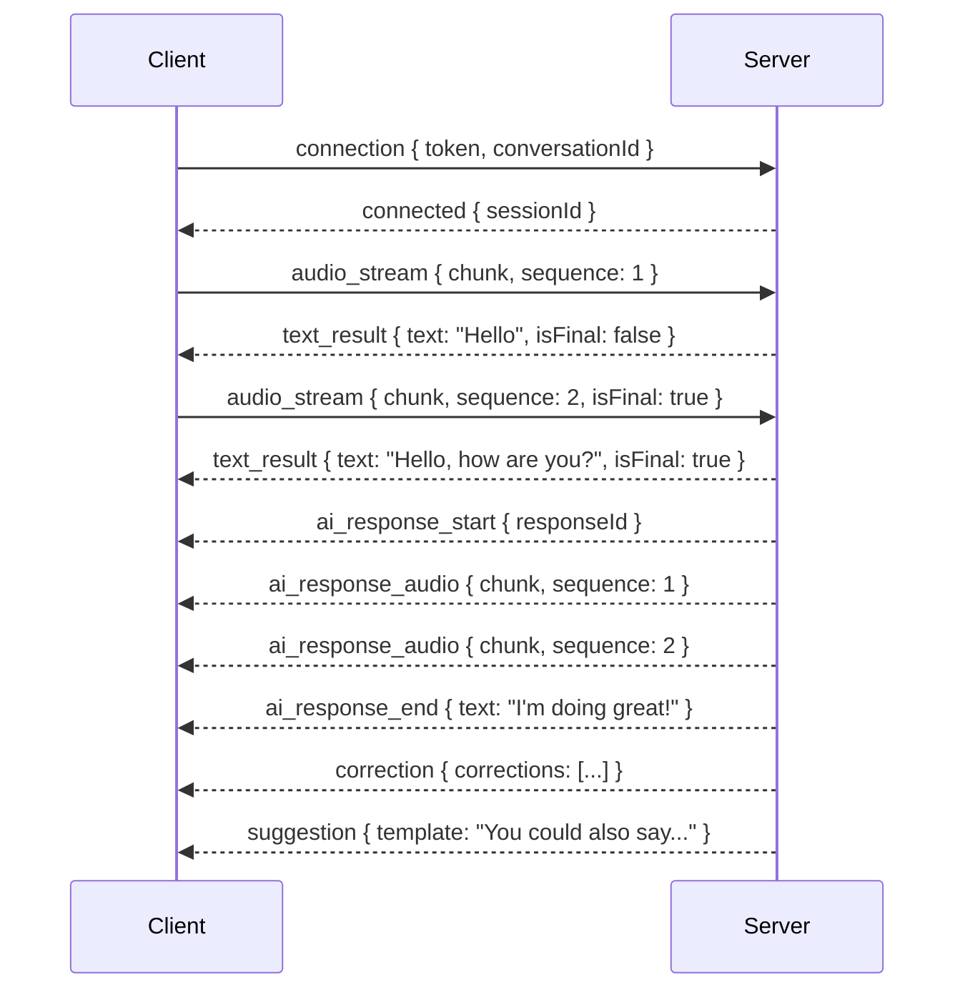

# 8.10. WebSocket APIs

## 接続

### Connection URL

```
wss://api.speakpal.app/ws/conversation
```

### Connection Request

```typescript
// Client → Server
interface ConnectionRequest {
  event: "connection";
  data: {
    token: string; // From POST /conversations response
    conversationId: string;
  };
}
```

### Connection Response

```typescript
// Server → Client
interface ConnectionResponse {
  event: "connected";
  data: {
    sessionId: string;
    serverTime: string;
  };
}
```

---

## イベント: audio_stream

### Client → Server

```typescript
interface AudioStreamEvent {
  event: "audio_stream";
  data: {
    chunk: string; // Base64 encoded audio
    sequence: number; // Chunk sequence number
    sampleRate: number; // Audio sample rate (16000)
    channels: number; // 1 = mono
    isFinal: boolean; // Last chunk of utterance
  };
}
```

### Server Response (text_result)

```typescript
interface TextResultEvent {
  event: "text_result";
  data: {
    text: string;
    isFinal: boolean;
    confidence: number; // 0.0 - 1.0
    timestamp: string;
  };
}
```

---

## イベント: ai_response

### Server → Client

```typescript
// Response start
interface AIResponseStartEvent {
  event: "ai_response_start";
  data: {
    responseId: string;
  };
}

// Audio chunk
interface AIResponseAudioEvent {
  event: "ai_response_audio";
  data: {
    chunk: string; // Base64 encoded audio
    sequence: number;
  };
}

// Response end
interface AIResponseEndEvent {
  event: "ai_response_end";
  data: {
    responseId: string;
    text: string; // Full response text
  };
}
```

---

## イベント: correction

### Server → Client

```typescript
interface CorrectionEvent {
  event: "correction";
  data: {
    corrections: Correction[];
  };
}

interface Correction {
  type: "grammar" | "vocabulary" | "pronunciation";
  originalText: string;
  correctedText: string;
  explanation: string;
  explanationJa: string;
  severity: "low" | "medium" | "high";
}
```

---

## イベント: suggestion

### Server → Client

```typescript
interface SuggestionEvent {
  event: "suggestion";
  data: {
    template: string;
    vocabulary: VocabSuggestion[];
    alternativeResponses: string[];
  };
}

interface VocabSuggestion {
  word: string;
  meaning: string;
  pronunciation: string;
}
```

---

## イベント: interrupt

### Client → Server

```typescript
interface InterruptEvent {
  event: "interrupt";
  data: {
    reason: "user_speaking" | "user_cancel";
  };
}
```

### Server Response

```typescript
interface ProcessingStoppedEvent {
  event: "processing_stopped";
  data: {
    message: string;
  };
}
```

---

## イベント: error

### Server → Client

```typescript
interface ErrorEvent {
  event: "error";
  data: {
    code: string;
    message: string;
    recoverable: boolean;
    action?: "retry" | "reconnect" | "end_conversation";
  };
}
```

### Error Codes

| Code       | Message                 | Action    |
| ---------- | ----------------------- | --------- |
| WS_ERR_001 | Invalid token           | reconnect |
| WS_ERR_002 | Session expired         | reconnect |
| WS_ERR_003 | STT service unavailable | retry     |
| WS_ERR_004 | LLM service unavailable | retry     |
| WS_ERR_005 | TTS service unavailable | retry     |
| WS_ERR_006 | Audio format invalid    | retry     |

---

## シーケンス例



---

← [Social APIs](./social-apis.md) | _戻る: [API 設計](../08-api-design.md)_
