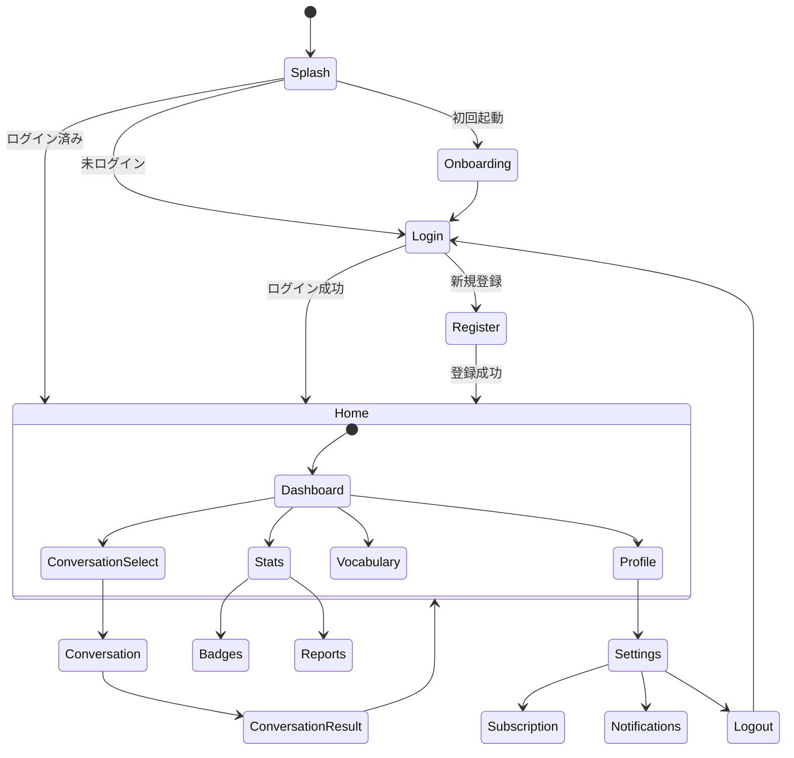

# 9. UI 仕様

> 📋 このドキュメントは UI 仕様の概要と各セクションへのリンクを提供します。

---

## 9.1. 概要

### 統計情報

| 項目       | 数量 |
| ---------- | ---- |
| 画面総数   | 20   |
| カバレッジ | 100% |

---

## 9.2. デザインシステム

### 9.2.1. カラーパレット

| 名前       | Light Mode       | Dark Mode | 用途            |
| ---------- | ---------------- | --------- | --------------- |
| Primary    | #6366F1 (Indigo) | #818CF8   | CTA, アクセント |
| Secondary  | #EC4899 (Pink)   | #F472B6   | 強調            |
| Success    | #10B981          | #34D399   | 成功、正解      |
| Warning    | #F59E0B          | #FBBF24   | 警告            |
| Error      | #EF4444          | #F87171   | エラー、不正解  |
| Background | #FFFFFF          | #111827   | 背景            |
| Surface    | #F9FAFB          | #1F2937   | カード背景      |
| Text       | #111827          | #F9FAFB   | テキスト        |

### 9.2.2. タイポグラフィ

| 要素       | Font  | Size | Weight   | 用途           |
| ---------- | ----- | ---- | -------- | -------------- |
| Headline 1 | Inter | 32px | Bold     | ページタイトル |
| Headline 2 | Inter | 24px | SemiBold | セクション     |
| Headline 3 | Inter | 20px | SemiBold | サブセクション |
| Body       | Inter | 16px | Regular  | 本文           |
| Body Small | Inter | 14px | Regular  | 補足テキスト   |
| Caption    | Inter | 12px | Regular  | キャプション   |
| Button     | Inter | 16px | SemiBold | ボタンテキスト |

### 9.2.3. スペーシング

| 名前 | 値   | 用途               |
| ---- | ---- | ------------------ |
| xs   | 4px  | アイコン間         |
| sm   | 8px  | 要素内パディング   |
| md   | 16px | カード内パディング |
| lg   | 24px | セクション間       |
| xl   | 32px | ページ余白         |
| 2xl  | 48px | 大セクション間     |

---

## 9.3. 画面詳細

> 📋 詳細な画面設計は以下のファイルを参照してください。

| セクション | ファイル                                                               | 内容                     |
| ---------- | ---------------------------------------------------------------------- | ------------------------ |
| 9.3.1      | [Auth Screens](./09-ui-specifications/auth-screens.md)                 | ログイン、新規登録       |
| 9.3.2      | [Conversation Screens](./09-ui-specifications/conversation-screens.md) | 会話、結果               |
| 9.3.3      | [Progress Screens](./09-ui-specifications/progress-screens.md)         | ホーム、統計、ランキング |

---

## 9.4. 画面一覧

### 9.3.1. 認証系 (4 画面)

| SCR ID  | 画面名           | 説明                       |
| ------- | ---------------- | -------------------------- |
| SCR-001 | スプラッシュ     | アプリ起動時のブランドロゴ |
| SCR-002 | オンボーディング | 初回起動時のチュートリアル |
| SCR-003 | ログイン         | メール/パスワードログイン  |
| SCR-004 | 新規登録         | アカウント作成             |

### 9.3.2. メイン系 (1 画面)

| SCR ID  | 画面名 | 説明                               |
| ------- | ------ | ---------------------------------- |
| SCR-005 | ホーム | ダッシュボード、クイックアクション |

### 9.3.3. 会話系 (3 画面)

| SCR ID  | 画面名   | 説明                             |
| ------- | -------- | -------------------------------- |
| SCR-006 | 会話選択 | モード/トピック選択              |
| SCR-007 | 会話画面 | リアルタイム会話インターフェース |
| SCR-008 | 会話結果 | サマリー、スコア、訂正一覧       |

### 9.3.4. 設定系 (4 画面)

| SCR ID  | 画面名             | 説明                 |
| ------- | ------------------ | -------------------- |
| SCR-009 | プロフィール       | ユーザー情報、レベル |
| SCR-010 | 設定               | アプリ設定一覧       |
| SCR-011 | サブスクリプション | プラン選択、購入     |
| SCR-012 | 通知設定           | 通知のオン/オフ      |

### 9.3.5. 進捗系 (3 画面)

| SCR ID  | 画面名             | 説明             |
| ------- | ------------------ | ---------------- |
| SCR-013 | 統計ダッシュボード | 学習統計、グラフ |
| SCR-014 | バッジコレクション | 獲得バッジ一覧   |
| SCR-015 | 週間/月間レポート  | 詳細レポート     |

### 9.3.6. 学習系 (3 画面)

| SCR ID  | 画面名             | 説明             |
| ------- | ------------------ | ---------------- |
| SCR-016 | 単語帳             | 保存した語彙一覧 |
| SCR-017 | 復習クイズ         | SRS 復習         |
| SCR-018 | デイリーチャレンジ | 本日のチャレンジ |

### 9.3.7. ソーシャル系 (2 画面)

| SCR ID  | 画面名     | 説明                 |
| ------- | ---------- | -------------------- |
| SCR-019 | 友達招待   | 招待コード生成・共有 |
| SCR-020 | ランキング | 週間 XP ランキング   |

---

## 9.4. 画面遷移図

---

## 9.5. コンポーネントライブラリ

### 9.5.1. ボタン

| バリアント | 用途                 | 色            |
| ---------- | -------------------- | ------------- |
| Primary    | CTA、主要アクション  | Primary color |
| Secondary  | 副次アクション       | Border only   |
| Danger     | 削除、危険アクション | Error color   |
| Ghost      | テキストリンク風     | Transparent   |

### 9.5.2. 入力フィールド

| タイプ   | 用途                 |
| -------- | -------------------- |
| Text     | テキスト入力         |
| Email    | メールアドレス       |
| Password | パスワード（マスク） |
| Search   | 検索ボックス         |

### 9.5.3. カード

| バリアント  | 用途               |
| ----------- | ------------------ |
| Default     | 一般的なカード     |
| Interactive | タップ可能なカード |
| Highlighted | 強調カード         |
| Stats       | 統計表示カード     |

---

## 9.6. レスポンシブ対応

| ブレークポイント | 幅         | 対象デバイス    |
| ---------------- | ---------- | --------------- |
| Mobile           | < 768px    | スマートフォン  |
| Tablet           | 768-1024px | タブレット      |
| Desktop          | > 1024px   | Web（将来対応） |

---

← [目次](./_index.md) | _次のセクション: [10-security-design.md](./10-security-design.md)_
