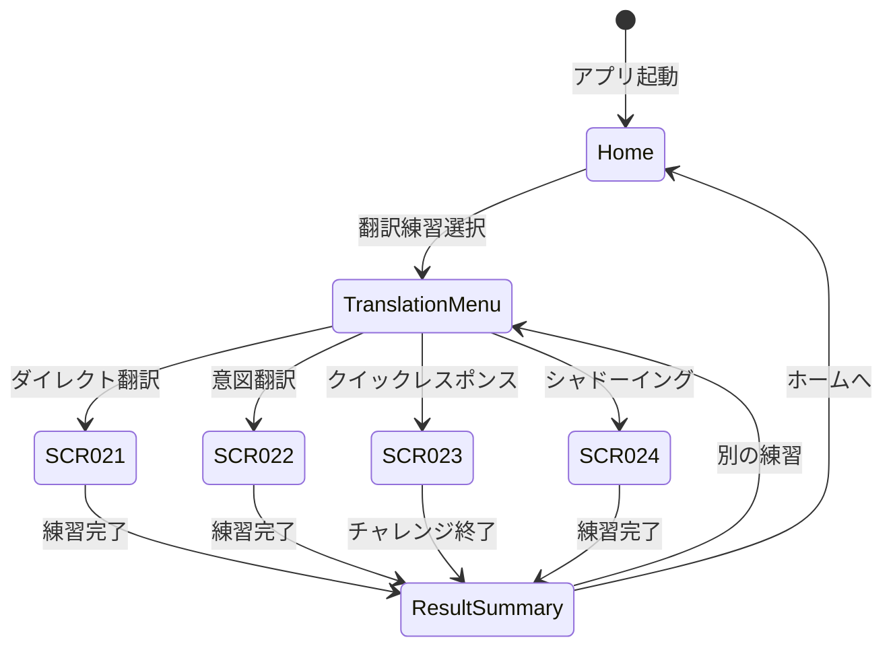

# 9.5. Translation Screens (SCR-021 ～ SCR-024)

> このファイルは翻訳練習機能（FR-034〜FR-038）に関する画面仕様を定義します。

---

## 画面サマリー

| SCR ID  | 画面名             | URL                      | 関連 UC        |
| ------- | ------------------ | ------------------------ | -------------- |
| SCR-021 | ダイレクト翻訳練習 | /translation/direct      | UC-034         |
| SCR-022 | 高度意図翻訳練習   | /translation/intent      | UC-035         |
| SCR-023 | クイックレスポンス | /practice/quick-response | UC-036, UC-037 |
| SCR-024 | シャドーイング練習 | /practice/shadowing      | UC-038         |

---

## SCR-021: ダイレクト翻訳練習画面

### 画面情報

| 項目    | 内容                   |
| ------- | ---------------------- |
| 画面 ID | SCR-021                |
| 画面名  | ダイレクト翻訳練習画面 |
| URL     | /translation/direct    |
| 認証    | 必須                   |
| 関連 UC | UC-034                 |

### ワイヤーフレーム

```
┌─────────────────────────────────────────────────────────────────┐
│  ← 戻る           ダイレクト翻訳練習           ⚙              │
├─────────────────────────────────────────────────────────────────┤
│  【トピック選択】                                               │
│   [日常会話▼] [ビジネス] [旅行] [ニュース]                      │
├─────────────────────────────────────────────────────────────────┤
│  📊 進捗: 5/10 問完了  |  🔥 連続正解: 3                       │
├─────────────────────────────────────────────────────────────────┤
│                                                                 │
│  【問題エリア】                                                 │
│  ┌───────────────────────────────────────────────────────────┐ │
│  │   🇯🇵 「今日の天気はとても良いですね」                     │ │
│  └───────────────────────────────────────────────────────────┘ │
│                                                                 │
│  【タイマー】  ⏱ 25秒                                          │
├─────────────────────────────────────────────────────────────────┤
│  【音声入力エリア】                                             │
│           ◉◉◉ 録音中... ◉◉◉                                   │
│           "The weather is very nice today..."                  │
├─────────────────────────────────────────────────────────────────┤
│  【結果エリア】(発話完了後)                                     │
│   スコア: 85/100 🌟🌟🌟🌟                                       │
│   文法: 90% | 語彙: 85% | 速度: 80%                            │
│                                                                 │
│   📝 あなたの翻訳: "The weather is very nice today"            │
│   ✓ 模範解答: "The weather is very nice today, isn't it?"      │
│   💡 ヒント: 付加疑問文を使うとより自然です                    │
├─────────────────────────────────────────────────────────────────┤
│        🎤 話す         ⏭ スキップ         🏠 終了             │
└─────────────────────────────────────────────────────────────────┘
```

### コンポーネント仕様

| ID          | 要素           | 型      | 必須 | バリデーション |
| ----------- | -------------- | ------- | ---- | -------------- |
| topic       | トピック選択   | select  | ○    | 1 つ選択必須   |
| timer       | タイマー表示   | display | -    | 0-30 秒        |
| question    | 問題文表示     | text    | -    | -              |
| recordBtn   | 録音ボタン     | button  | -    | マイク権限必須 |
| transcript  | 認識テキスト   | text    | -    | -              |
| score       | スコア表示     | display | -    | 0-100          |
| modelAnswer | 模範解答       | text    | -    | -              |
| feedback    | フィードバック | text    | -    | -              |

### イベント定義

| イベント         | トリガー              | アクション                 |
| ---------------- | --------------------- | -------------------------- |
| onTopicChange    | トピック選択変更      | API: getQuestion()         |
| onStartRecording | 「話す」ボタンタップ  | 録音開始、タイマー開始     |
| onStopRecording  | 録音停止/タイムアウト | API: evaluateTranslation() |
| onPlayModel      | 模範解答再生          | TTS 再生                   |
| onSkip           | スキップタップ        | 次の問題取得               |
| onFinish         | 終了タップ            | 結果サマリー画面遷移       |

---

## SCR-022: 高度意図翻訳練習画面

### 画面情報

| 項目    | 内容                      |
| ------- | ------------------------- |
| 画面 ID | SCR-022                   |
| 画面名  | 高度意図翻訳練習画面      |
| URL     | /translation/intent       |
| 認証    | 必須（Intermediate 以上） |
| 関連 UC | UC-035                    |

### ワイヤーフレーム

```
┌─────────────────────────────────────────────────────────────────┐
│  ← 戻る           高度意図翻訳練習           ⚙                │
├─────────────────────────────────────────────────────────────────┤
│  【カテゴリ選択】                                               │
│   [挨拶] [日常] [ビジネス▼] [感情表現]                         │
├─────────────────────────────────────────────────────────────────┤
│  【意図説明エリア】                                             │
│  ┌───────────────────────────────────────────────────────────┐ │
│  │  📋 シチュエーション:                                     │ │
│  │  「会議で同僚の提案に反対したいのですが、                 │ │
│  │   失礼にならないように丁寧に意見を述べてください」        │ │
│  └───────────────────────────────────────────────────────────┘ │
├─────────────────────────────────────────────────────────────────┤
│  【音声入力エリア】                                             │
│           ◉◉◉ 録音中... ◉◉◉                                   │
│  "I appreciate your idea, but I have a different perspective..." │
├─────────────────────────────────────────────────────────────────┤
│  【評価結果】                                                   │
│   総合評価: 88/100 ⭐⭐⭐⭐                                      │
│   意図一致: 90% | 自然さ: 85% | 語彙: 88%                      │
│                                                                 │
│   ✅ 良い点: 丁寧な反対表現を使用                              │
│   💡 改善点: "However" を使うとより論理的                      │
├─────────────────────────────────────────────────────────────────┤
│  【代替表現】                                                   │
│   1. "I see your point, however..."    🔊                      │
│   2. "That's an interesting idea, but..." 🔊                   │
│   3. "I respectfully disagree because..." 🔊                   │
├─────────────────────────────────────────────────────────────────┤
│        🎤 話す         ⏭ 次へ             🏠 終了             │
└─────────────────────────────────────────────────────────────────┘
```

### コンポーネント仕様

| ID           | 要素           | 型      | 必須 | バリデーション |
| ------------ | -------------- | ------- | ---- | -------------- |
| category     | カテゴリ選択   | select  | ○    | 1 つ選択必須   |
| intent       | 意図説明       | text    | -    | -              |
| transcript   | 認識テキスト   | text    | -    | 3 語以上       |
| score        | スコア表示     | display | -    | 0-100          |
| alternatives | 代替表現リスト | list    | -    | 3 件以上       |
| playBtn      | 再生ボタン     | button  | -    | -              |

---

## SCR-023: クイックレスポンス画面

### 画面情報

| 項目    | 内容                     |
| ------- | ------------------------ |
| 画面 ID | SCR-023                  |
| 画面名  | クイックレスポンス画面   |
| URL     | /practice/quick-response |
| 認証    | 必須                     |
| 関連 UC | UC-036, UC-037           |

### ワイヤーフレーム（ワード連想モード）

```
┌─────────────────────────────────────────────────────────────────┐
│  ← 戻る          クイックレスポンス           ⚙               │
├─────────────────────────────────────────────────────────────────┤
│  【モード選択】                                                 │
│   [ワード連想🎯] [瞬間応答⚡]                                   │
├─────────────────────────────────────────────────────────────────┤
│  ┌───────────────────────────────────────────────────────────┐ │
│  │  ⏱ 残り時間: 45秒   |   🏆 スコア: 1,250   |   🔥 x5    │ │
│  └───────────────────────────────────────────────────────────┘ │
├─────────────────────────────────────────────────────────────────┤
│  【キーワードエリア】                                           │
│  ┌───────────────────────────────────────────────────────────┐ │
│  │              🎯 "WEATHER"                                 │ │
│  │                  (関連語を言ってください)                 │ │
│  │         ⏱ 5秒 ████████░░░                                │ │
│  └───────────────────────────────────────────────────────────┘ │
├─────────────────────────────────────────────────────────────────┤
│  【回答履歴】                                                   │
│   ✓ TRAVEL → "passport" (+100)                                 │
│   ✓ FOOD → "delicious" (+100)                                  │
│   ✗ MUSIC → (timeout)                                          │
│   ✓ WEATHER → "sunny" (+150) 🔥CHAIN!                          │
├─────────────────────────────────────────────────────────────────┤
│              🎤 録音中...  "sunny"                             │
├─────────────────────────────────────────────────────────────────┤
│       [一時停止]          [終了]                               │
└─────────────────────────────────────────────────────────────────┘
```

### コンポーネント仕様

| ID            | 要素         | 型      | 必須 | バリデーション |
| ------------- | ------------ | ------- | ---- | -------------- |
| mode          | モード選択   | tab     | ○    | 1 つ選択必須   |
| totalTimer    | 全体タイマー | display | -    | 0-60 秒        |
| questionTimer | 問題タイマー | display | -    | 0-10 秒        |
| score         | スコア表示   | display | -    | 0 以上         |
| chain         | チェーン表示 | display | -    | 0 以上         |
| keyword       | キーワード   | text    | -    | -              |
| history       | 履歴リスト   | list    | -    | -              |

---

## SCR-024: シャドーイング練習画面

### 画面情報

| 項目    | 内容                   |
| ------- | ---------------------- |
| 画面 ID | SCR-024                |
| 画面名  | シャドーイング練習画面 |
| URL     | /practice/shadowing    |
| 認証    | 必須                   |
| 関連 UC | UC-038                 |

### ワイヤーフレーム

```
┌─────────────────────────────────────────────────────────────────┐
│  ← 戻る           シャドーイング練習           ⚙              │
├─────────────────────────────────────────────────────────────────┤
│  【コンテンツ選択】                                             │
│   [会話] [ニュース▼] [スピーチ] [ポッドキャスト]                │
├─────────────────────────────────────────────────────────────────┤
│  【速度設定】                                                   │
│   [0.75x] [1.0x▼] [1.25x]    □ 字幕表示                        │
├─────────────────────────────────────────────────────────────────┤
│  【再生エリア】                                                 │
│  ┌───────────────────────────────────────────────────────────┐ │
│  │  ▶ ━━━━━━━━━━━━●━━━━━━━━━━━━  01:23 / 02:30             │ │
│  │                                                           │ │
│  │  📝 字幕: "Climate change is one of the most pressing     │ │
│  │          issues facing our planet today..."               │ │
│  │                                                           │ │
│  │  🎤 あなた: "Climate change is one of the most..."       │ │
│  └───────────────────────────────────────────────────────────┘ │
├─────────────────────────────────────────────────────────────────┤
│  【リアルタイム分析】                                           │
│   追従: ████████░░ 80%                                         │
│   発音: █████████░ 90%                                         │
│   リズム: ███████░░ 75%                                        │
├─────────────────────────────────────────────────────────────────┤
│  【結果】（練習完了後）                                         │
│   総合スコア: 82/100 ⭐⭐⭐⭐                                    │
│   ✅ 良い点: 発音がクリア                                      │
│   💡 改善点: イントネーションをもう少し意識                    │
│   [🔄 もう一度] [📍 苦手部分を練習] [▶ 次のコンテンツ]         │
├─────────────────────────────────────────────────────────────────┤
│       ⏸ 一時停止       🎤 録音開始/停止       🏠 終了         │
└─────────────────────────────────────────────────────────────────┘
```

### コンポーネント仕様

| ID             | 要素           | 型       | 必須 | バリデーション |
| -------------- | -------------- | -------- | ---- | -------------- |
| contentType    | コンテンツ種別 | select   | ○    | 1 つ選択必須   |
| playbackSpeed  | 再生速度       | select   | ○    | 0.75/1.0/1.25  |
| showSubtitle   | 字幕表示       | checkbox | -    | -              |
| progressBar    | プログレスバー | slider   | -    | 0-duration     |
| subtitle       | 字幕テキスト   | text     | -    | -              |
| userSpeech     | ユーザー発話   | text     | -    | -              |
| followingScore | 追従スコア     | progress | -    | 0-100          |
| pronScore      | 発音スコア     | progress | -    | 0-100          |
| rhythmScore    | リズムスコア   | progress | -    | 0-100          |

### イベント定義

| イベント        | トリガー       | アクション              |
| --------------- | -------------- | ----------------------- |
| onContentSelect | コンテンツ選択 | API: getContent()       |
| onSpeedChange   | 速度変更       | 再生速度調整            |
| onPlay          | 再生ボタン     | 音声再生開始            |
| onStartRecord   | 録音開始       | ユーザー録音開始        |
| onStopRecord    | 録音停止       | API: analyzeShadowing() |
| onRepeat        | もう一度       | 同じコンテンツで再開    |
| onPracticeWeak  | 苦手部分を練習 | 苦手セグメントのみ再生  |

---

## 画面遷移図



---

## レスポンシブ対応

### ブレークポイント

| サイズ | 幅         | レイアウト調整 |
| ------ | ---------- | -------------- |
| xs     | < 375px    | 最小レイアウト |
| sm     | 375-639px  | モバイル標準   |
| md     | 640-767px  | タブレット縦   |
| lg     | 768-1023px | タブレット横   |
| xl     | ≥ 1024px   | デスクトップ   |

### モバイル最適化

- タイマー表示を画面上部に固定
- 録音ボタンを親指で押しやすい位置に配置
- 結果表示はスクロール可能なカード形式

---

## アクセシビリティ

### キーボードナビゲーション

| キー   | 動作                   |
| ------ | ---------------------- |
| Space  | 録音開始/停止          |
| Enter  | 次の問題               |
| Escape | 練習終了確認ダイアログ |
| Tab    | フォーカス移動         |

### スクリーンリーダー対応

- 問題文読み上げ機能
- スコア結果の音声フィードバック
- 進捗状況の Aria-live 更新

---

## カバレッジサマリー

| SCR ID  | 画面名             | ワイヤーフレーム | コンポーネント | イベント | ステータス |
| ------- | ------------------ | ---------------- | -------------- | -------- | ---------- |
| SCR-021 | ダイレクト翻訳     | ✅               | ✅             | ✅       | ✅ 完了    |
| SCR-022 | 意図翻訳           | ✅               | ✅             | ✅       | ✅ 完了    |
| SCR-023 | クイックレスポンス | ✅               | ✅             | ✅       | ✅ 完了    |
| SCR-024 | シャドーイング     | ✅               | ✅             | ✅       | ✅ 完了    |

---

← [Learning Screens](./learning-screens.md) | [目次](../09-ui-specifications.md)
