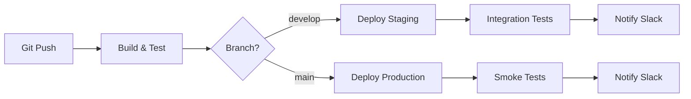

# 13. デプロイメント設計

## 13.1. 概要

本章では SpeakPal AI のデプロイメントアーキテクチャを定義します。

---

## 13.2. 環境構成

### 13.2.1. 環境一覧

| 環境        | 用途                 | クラスタ        |
| ----------- | -------------------- | --------------- |
| Development | 開発・ローカルテスト | Docker Compose  |
| Staging     | 統合テスト、QA       | K8s (1-2 nodes) |
| Production  | 本番サービス         | K8s (3+ nodes)  |

### 13.2.2. 環境別設定

| 設定項目        | Dev   | Staging     | Production   |
| --------------- | ----- | ----------- | ------------ |
| DB インスタンス | Local | RDS (small) | RDS (medium) |
| Redis           | Local | ElastiCache | ElastiCache  |
| レプリカ数      | 1     | 2           | 3+           |
| ログレベル      | DEBUG | INFO        | INFO         |
| 外部 API        | Mock  | Sandbox     | Production   |

---

## 13.3. Kubernetes アーキテクチャ

### 13.3.1. Namespace 構成

```yaml
namespaces:
  - speakpal-production
  - speakpal-staging
  - speakpal-monitoring
  - speakpal-ingress
```

### 13.3.2. Deployment 構成

```yaml
apiVersion: apps/v1
kind: Deployment
metadata:
  name: conversation-service
  namespace: speakpal-production
spec:
  replicas: 3
  selector:
    matchLabels:
      app: conversation-service
  template:
    metadata:
      labels:
        app: conversation-service
    spec:
      containers:
        - name: conversation-service
          image: speakpal/conversation-service:v1.0.0
          ports:
            - containerPort: 3000
          resources:
            requests:
              memory: "256Mi"
              cpu: "250m"
            limits:
              memory: "512Mi"
              cpu: "500m"
          livenessProbe:
            httpGet:
              path: /health
              port: 3000
            initialDelaySeconds: 10
            periodSeconds: 10
          readinessProbe:
            httpGet:
              path: /ready
              port: 3000
            initialDelaySeconds: 5
            periodSeconds: 5
          envFrom:
            - secretRef:
                name: conversation-service-secrets
            - configMapRef:
                name: conversation-service-config
```

### 13.3.3. Service 構成

```yaml
apiVersion: v1
kind: Service
metadata:
  name: conversation-service
spec:
  selector:
    app: conversation-service
  ports:
    - port: 80
      targetPort: 3000
  type: ClusterIP
```

### 13.3.4. HPA (Horizontal Pod Autoscaler)

```yaml
apiVersion: autoscaling/v2
kind: HorizontalPodAutoscaler
metadata:
  name: conversation-service-hpa
spec:
  scaleTargetRef:
    apiVersion: apps/v1
    kind: Deployment
    name: conversation-service
  minReplicas: 3
  maxReplicas: 10
  metrics:
    - type: Resource
      resource:
        name: cpu
        target:
          type: Utilization
          averageUtilization: 70
    - type: Resource
      resource:
        name: memory
        target:
          type: Utilization
          averageUtilization: 80
```

---

## 13.4. CI/CD パイプライン

### 13.4.1. パイプライン構成



### 13.4.2. GitHub Actions Workflow

```yaml
name: CI/CD Pipeline

on:
  push:
    branches: [main, develop]
  pull_request:
    branches: [main]

jobs:
  build-and-test:
    runs-on: ubuntu-latest
    steps:
      - uses: actions/checkout@v4
      - name: Setup Node.js
        uses: actions/setup-node@v4
        with:
          node-version: "20"
          cache: "npm"

      - name: Install dependencies
        run: npm ci

      - name: Lint
        run: npm run lint

      - name: Test
        run: npm run test:cov

      - name: Build
        run: npm run build

      - name: Build Docker image
        run: docker build -t speakpal/${{ github.job }}:${{ github.sha }} .

  deploy-staging:
    needs: build-and-test
    if: github.ref == 'refs/heads/develop'
    runs-on: ubuntu-latest
    steps:
      - name: Deploy to Staging
        run: |
          kubectl set image deployment/app \
            app=speakpal/app:${{ github.sha }} \
            -n speakpal-staging

  deploy-production:
    needs: build-and-test
    if: github.ref == 'refs/heads/main'
    runs-on: ubuntu-latest
    environment: production
    steps:
      - name: Deploy to Production
        run: |
          kubectl set image deployment/app \
            app=speakpal/app:${{ github.sha }} \
            -n speakpal-production
```

---

## 13.5. デプロイ戦略

### 13.5.1. Rolling Update

```yaml
spec:
  strategy:
    type: RollingUpdate
    rollingUpdate:
      maxSurge: 1 # 最大追加 Pod 数
      maxUnavailable: 0 # 最大停止 Pod 数
```

### 13.5.2. Rollback 手順

```bash
# 直前のリビジョンに戻す
kubectl rollout undo deployment/conversation-service

# 特定リビジョンに戻す
kubectl rollout undo deployment/conversation-service --to-revision=3

# ロールアウト履歴確認
kubectl rollout history deployment/conversation-service
```

---

## 13.6. インフラストラクチャ (AWS)

### 13.6.1. サービス構成

| サービス         | 用途                       |
| ---------------- | -------------------------- |
| EKS              | Kubernetes クラスタ        |
| RDS (PostgreSQL) | データベース               |
| ElastiCache      | Redis キャッシュ           |
| S3               | 静的ファイル・バックアップ |
| CloudFront       | CDN                        |
| ALB              | ロードバランサー           |
| Route 53         | DNS                        |
| Secrets Manager  | シークレット管理           |
| CloudWatch       | ログ・モニタリング         |

### 13.6.2. ネットワーク構成

```
┌─────────────────────────────────────────────────────────────┐
│                          VPC                                 │
│  ┌─────────────────────────────────────────────────────┐   │
│  │                 Public Subnet                        │   │
│  │   ┌─────────┐   ┌─────────┐                         │   │
│  │   │   ALB   │   │   NAT   │                         │   │
│  │   └─────────┘   └─────────┘                         │   │
│  └─────────────────────────────────────────────────────┘   │
│  ┌─────────────────────────────────────────────────────┐   │
│  │                Private Subnet                        │   │
│  │   ┌─────────────┐   ┌─────────────┐                 │   │
│  │   │ EKS Cluster │   │    RDS      │                 │   │
│  │   └─────────────┘   └─────────────┘                 │   │
│  │   ┌─────────────┐                                   │   │
│  │   │ ElastiCache │                                   │   │
│  │   └─────────────┘                                   │   │
│  └─────────────────────────────────────────────────────┘   │
└─────────────────────────────────────────────────────────────┘
```

---

## 13.7. バックアップ・DR

### 13.7.1. バックアップ戦略

| 対象         | 頻度   | 保持期間 | 方式                 |
| ------------ | ------ | -------- | -------------------- |
| DB スナップ  | 日次   | 30 日    | RDS 自動バックアップ |
| DB WAL       | 継続   | 7 日     | S3 アーカイブ        |
| 設定ファイル | 変更時 | 永久     | Git                  |
| シークレット | 変更時 | 30 日    | Secrets Manager      |

### 13.7.2. DR 目標

| 指標 | 目標値 |
| ---- | ------ |
| RTO  | 4 時間 |
| RPO  | 1 時間 |

---

← [目次](./_index.md) | _次のセクション: [14-appendices.md](./14-appendices.md)_
